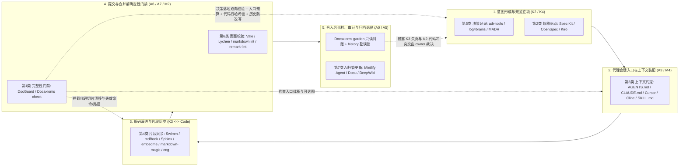

# Docaxioms 与同类工具及文档系统对比调研报告

## 1. 评估基线、调研日期与证据限制

### 1.1 被评估对象与锁定快照

- **目标仓库**：https://github.com/Zephinel/docaxioms （npm 包名 `docaxioms`，当前发布版本 `0.1.0-alpha.0`，发布于 `2026-11-23T15:30:45.800Z`，MIT 许可证，GitHub Stars 为 `0`）[R1, R5] —— **结论：`已验证为真`**。
- **锁定评估基线（Commit SHA）**：`8336bed3bbcfc7ff99a01fb9549142c7260a5aa9`（短哈希 `8336bed`，位于分支 `readme-drop-ids` HEAD）[R1] —— **结论：`已验证为真`**。
- **与默认分支 `main` 的基线对照说明**：当前仓库默认分支 `main` 指向 `0d8e1bb2ed235657a8fb8ee86f8917f9865abe10`（短哈希 `0d8e1bb`），落后 `8336bed` 共 `3` 个提交（`86dffc1`、`7f4a4ff`、`8336bed`）[R1, R4]。鉴于本次调研要求保持只读不修改仓库，且明确要求读取 `AD-1` 至 `AD-7`（其中 `AD-7` 与自检测试 [self.test.mjs](../../test/self.test.mjs) 仅存在于 `8336bed`，而 `0d8e1bb` 仅含 `AD-1` 至 `AD-6` 且当时尚未删除 `AD-5`），本报告以 **`8336bed3bbcfc7ff99a01fb9549142c7260a5aa9`** 作为唯一主评估基线，并在涉及 `AD-5` 与自检变更处同步注明 `0d8e1bb` 的状态 [R1, R4] —— **结论：`已验证为真`**。
- **调研与证据访问日期**：`2026-11-24`（全部 GitHub 源码树、Releases API、npm/PyPI/Crates 注册表、官方文档站点及 arXiv 论文均于 `2026-11-24` 核验）。
- **基线自检运行状态**：在 `8336bed` 上只读执行 `npm run check`，`node:test` 共 `102` 个测试全部通过，自检 `node bin/docaxioms.mjs check --report` 的 `16` 项内置检查（`14` 个 `gate`、`2` 个 `aid`）全部输出 `ok`（其中历史与映射检查在无变更工作树上按预期通过）[R2, R4] —— **结论：`已验证为真`**。

### 1.2 锁定基线完整文件清单（`git ls-tree -r --name-only 8336bed`，共 32 个文件）

```text
.github/workflows/check.yml
.gitignore
AGENTS.md
LICENSE
README.md
bin/docaxioms.mjs
core/AXIOMS.lock.md
core/GARDEN.md
core/GUIDE.md
core/LICENSE
docaxioms.json
docs/decisions.md
package-lock.json
package.json
src/check.mjs
src/garden.mjs
src/index.mjs
src/manage.mjs
src/markdown.mjs
src/pins.mjs
templates/AGENTS.md
templates/CLAUDE.md
templates/CURRENT.md
templates/docaxioms.json
templates/docs/README.md
templates/docs/decisions.md
templates/docs/history/README.md
templates/docs/log.md
templates/docs/plan.md
test/check.test.mjs
test/docaxioms.test.mjs
test/self.test.mjs
```

*(注：`main` 分支 `0d8e1bb` 共 `31` 个文件，唯一文件级差异是不含 `test/self.test.mjs` [R1, R4]。)*

### 1.3 审查深度对等与证据边界声明

1. **一手源码级核验对象（共 19 个开源仓库/工具，均逐文件读取真实发布标签或锁定提交源码）**：
   - 被评估对象：`Docaxioms`（`0.1.0-alpha.0` @ `8336bed` 全仓 `32` 个文件逐行通读，并在系统临时目录执行沙盒复现）[R1, R2, R3, R4]。
   - 对比对象：`DocGuard`（`v0.50.0`）[R6, R7, R8]、`GitHub Spec Kit`（`v1.4.4`）[R11, R12, R13]、`OpenSpec`（`v2.2.0`）[R14, R15, R16]、`AGENTS.md`（`main@d001185`）及 OpenAI Codex 加载器源码 [R20, R21]、`Cline`（`v4.1.27` 仓库检索）[R24]、`Agent Skills / skills-ref`（`v0.1.0` @ `83021e2`）[R25]、`mdBook`（`v0.5.4`）[R30]、`Sphinx`（`v9.2.0`）[R31]、`embedme`（`v1.22.1`）[R32]、`markdown-magic`（`4.11.1`）[R33]、`cog / cogapp`（`v3.6.1`）[R34]、`adr-tools`（`3.0.0` @ `b3279ba`）[R35]、`log4brains`（`v1.1.0`）[R36]、`MADR`（`4.0.0`）[R37]、`Vale`（`v3.28.1`）[R38]、`Lychee`（`lychee-v0.24.2`）[R40]、`markdownlint`（`v0.42.2`）+ `markdownlint-cli2`（`v0.24.2`）[R42, R43]、`remark-lint`（`10.0.1`）[R44]、`@dosu/cli`（`v0.69.0`）[R47] —— **结论：`已验证为真`**。
2. **官方技术文档 + 开源外围脚本核验的闭源商业系统（共 7 个）**：
   - `Swimm`（SaaS `1.65.0` / `Swimm 2` 官方技术文档 + 开源 `swimm-verify-action@v1.4`、`swimmio/pre-commit@v0.7`、`.sw.md` 真实样本与 USPTO 授权专利；其闭源二进制 `packed-swimm-linux-cli` 内部置信度评分权重与 `swimm-2-mcp` 具体 Tool Schema 不可见，标记为 `无法核实`）[R27, R28, R29]。
   - `AWS Kiro`（IDE `1.5.11`/`1.5.37`、CLI `3.6.0` 官方技术文档；其闭源 Harness 内部 EARS 解析器、PBT 生成器与并发 Wave 锁机制不可见，标记为 `无法核实`）[R17, R18, R19]。
   - `CLAUDE.md`（Claude Code `v2.1.332` 官方技术文档）[R22, R26]、`Cursor rules`（Cursor 官方技术文档）[R23]、`Mintlify Agent`（官方文档与 OpenAPI v2）[R45, R46]、`Dosu` 云端引擎（官方技术文章与 `@dosu/cli` 源码）[R47, R48]、`DeepWiki / Devin Wiki`（Cognition 官方技术文档）[R50]。凡仅见于客户证言或商业宣传页而无技术文档与公开基准支撑的效能数字，一律显式标注 `厂商自报`（在表格中注明仅据公开宣传）—— **结论：`已验证为真`**。
3. **引号与术语规范**：本报告严格执行引文纪律——正文中凡出现英文双引号 `"..."` 处，均为原封不动照录的英文源码字符串或原始文献原文；一切中文归纳、分类枚举与释义均使用加粗或反引号，绝不放入引号内。公理仅引用编号（`A0`–`A8`、`M1`–`M4`、`AD-1`–`AD-7`），不复述公理原文。

---

## 2. 定位图：Docaxioms 与各类工具守住的生命周期阶段

### 2.1 全生命周期防线定位图



### 2.2 各类别生命周期职责边界对比

- **Docaxioms（跨阶段契约粘合层，聚焦 S1↔S2↔S3↔S4↔S5 的结构与引用不变量）**：自身不生成业务规格、不内置 LLM、也不替代散文拼写或 Markdown 排版检查；它在 S1 用单表决策状态机与双向 `Landing` 守住 `A0`/`A4`/`A8`，在 S2 用入口 BFS 可达图与 `card`/`budgets` 行字符上限守住 `A3`/`M4`，在 S3/S4 用非侵入式 HTML 注释哈希锚 [pins.mjs](../../src/pins.mjs)、内联路径检查与命令键存在性检查守住 `A2`/`A6`/`A7`，在 S5 用基于 Git merge-base 的 `history/` 只读勘误门禁守住 `A5`，并用只读 `garden` 清单辅助人工或代理核查散文真值 [R1, R2, R3] —— **结论：`已验证为真`**。
- **第 1 类（`DocGuard`）**：与 Docaxioms 同处 S4 确定性门禁象限，但向业务代码纵深大幅扩张（覆盖 HTTP 路由、ORM Schema、环境变量、密钥扫描、AST 符号指纹与代码自动生成段落同步 `sync --write`），代价是引入 10 类配置/锁文件与更高的规则表面维护成本 [R6, R7, R8] —— **结论：`已验证为真`**。
- **第 2 类（`Spec Kit`、`OpenSpec`、`Kiro`）**：重心在 **S1→S3 变更前向规划与任务拆解**（K4 计划态）。除 `OpenSpec` 在文档内部实现了严密的 `ADDED`/`MODIFIED`/`REMOVED`/`RENAMED` 归档合并校验、以及 `Kiro` 提供 IDE 内置可选 PBT 与 Shell Hook 外，三者均缺乏零 LLM 的全仓代码↔现行文档静态漂移门禁 [R12, R15, R18] —— **结论：`已验证为真`**。
- **第 3 类（`AGENTS.md`、`CLAUDE.md`、`Cursor rules`、`Cline Memory Bank`、`SKILL.md`）**：重心完全在 **S2 会话上下文加载调度**（谁在何时进入提示词窗口），对文档内写的路径、命令、架构描述是否早已与代码脱节不做任何确定性校验 [R20, R22, R23, R24, R25] —— **结论：`已验证为真`**。
- **第 4 类（`Swimm`、`mdBook`、`Sphinx`、`embedme`、`markdown-magic`、`cog`）**：重心在 **S3 代码片段复用与展示同步**。除 `Swimm` 在超出阈值时阻断外，其余开源工具普遍将代码视为唯一上游，自动把最新代码投影或覆写进文档代码块，无法识别代码变更已使紧邻散文失真 [R27, R30, R31, R32, R33, R34] —— **结论：`已验证为真`**。
- **第 5 类（`adr-tools`、`log4brains`、`MADR`）**：仅覆盖 **S1 决策起草与目录展示**，均无 CI 断链门禁、无代码落地双向锚定、无防静默改写锁 [R35, R36, R37] —— **结论：`已验证为真`**。
- **第 6 类（`Vale`、`Lychee`、`markdownlint`、`remark-lint`）**：专精 **S4 单维形式门禁**（散文风格、URL/锚点连通性、CommonMark/GFM 排版语法），不理解业务源码、命令表或 M1 四类文档角色 [R38, R40, R42, R44] —— **结论：`已验证为真`**。
- **第 7 类（`Mintlify Agent`、`Dosu`、`DeepWiki`）**：位于 **S5 代码变更触发的 AI 异步跟进层**，以降低人工写文档负担为目标，但普遍以已发生或待合入的代码变更为触发源反向改写文档，缺少受锁保护的 K2 意图权威层 [R45, R48, R50] —— **结论：`已验证为真`**。

### 2.3 生命周期各环节的外部实证研究证据与可迁移性核验

以下逐条核验 2024–2026 年相关实证论文与技术报告（均先交代测量对象、实验条件、统计量与显著性，再判定能否迁移至 Docaxioms）：

1. **入口上下文文件对任务解决率与推理成本的影响 — Gloaguen et al. (2026)** [R51]：
   - **测量设计**：在 `SWE-bench Lite`（`11` 个 Python 仓库 `300` 题）与 `CTXbench`（`12` 个含真实上下文文件的 Python 仓库 `138` 题）上，测试 4 组代理（Claude Code + `Sonnet-4.5`、Codex + `GPT-5.2`、Codex + `GPT-5.1 mini`、Qwen Code + `Qwen3-30b-coder`）在无上下文文件（`None`）、初始化命令自动生成文件（`LLM`）与开发者原文件（`Dev`）三组条件下的单测解决率与成本 [R51]。
   - **统计量与显著性**：双侧 Cochran-Mantel-Haenszel 检验显示，`LLM` 自动生成文件相对 `None` 在 `SWE-bench Lite` 上解决率变化 `-0.5%`（`p = 0.87`，不显著），在 `CTXbench` 上 `-2%`（`p = 0.37`，不显著）；`Dev` 相对 `None` 提升 `+2.4%`（`p = 0.21`，不显著），`Dev` 相对 `LLM` 高出 `+7%`（`p = 0.038`，显著）；但加载上下文文件使平均交互步数增加 `2.45`–`3.92` 步，**平均推理成本上升超 `20%`（置换检验 `p < 10^{-5}`，高度显著）**，且文件内的代码库概览未减少定位目标补丁文件的步数 [R51] —— **结论：`已验证为真`**。
   - **迁移判定**：**`不可直接迁移`**（被测文件为无预算限制的全景概览式 `AGENTS.md`/`CLAUDE.md`，而 Docaxioms 用 `budgets` 与 `M4` 强制入口只做精简路由图；但该数据从反面支撑了 `A3`/`M4` 拒绝在根入口堆砌大段代码概览的设计）。
2. **小型 PR 上的运行耗时与 Token 变化 — Lulla et al. (2026)** [R52]：
   - **测量设计**：从仅含单一根 `AGENTS.md` 的 `10` 个仓库抽样 `124` 个小型纯代码 PR（`<= 100` LoC、`<= 5` 文件），仅用 Codex CLI + `gpt-5.2-codex` 对比保留与移除 `AGENTS.md` 的耗时与 token，**未运行项目测试套件校验补丁功能正确性** [R52]。
   - **统计量与显著性**：Wilcoxon 符号秩检验显示，有 `AGENTS.md` 时墙钟时间中位数从 `98.57s` 降至 `70.34s`（`p < 0.05`），输出 token 中位数从 `2,925` 降至 `2,440`（`p < 0.05`）；但**输入 token、缓存 token 与总 token 均不显著（`p >= 0.05`），总 token 中位数反而从 `223,707` 微升至 `226,582`** [R52] —— **结论：`已验证为真`**。
   - **迁移判定**：**`不可直接迁移`**（排除了多文件文档体系、仅限百行内修改且未验单测正确率）。
3. **双代理小样本真实仓库消融与探测调优 — Khatri (2026) & Shepard & Albrecht (2026)** [R53, R54]：
   - **测量设计与统计量**：Khatri 在 `3` 个仓库 `17` 个任务共 `288` 次黄金测试运行上做等效性检验，发现上下文注入策略对 Claude Code 与 Codex 正确率无显著提升（效应上界 `<= 10–15` 个百分点）[R53]；Shepard & Albrecht 在 `SWE-bench Verified` 上用合成 bug 离线探测迭代调优 `AGENTS.md`，使开源模型 `Qwen3.5-35B-A3B` 解决率从无指南 `25.5%`、静态知识库 `28.3%` 升至 `33.0%`（均 `p < 0.001`），但单补丁精确率不变（约 `59%`，`p = 0.119`），且在 `Nemotron-3-Nano-30B-A3B` 上退化 [R54] —— **结论：`已验证为真`**。
   - **迁移判定**：两项结果均 **`不可直接迁移`**（Docaxioms 的目标并非离线提示词调优以提高通用单测刷榜分，而是跨会话守住 `A0`/`A8` 决策与文档一致性）。
4. **`SKILL.md` 具体命令/路径增益与按需加载折损 — Wang et al. (2026)** [R55]：
   - **测量设计**：基于 `3,159` 个 `SKILL.md` 的 `2,608` 对首末版本，构造 `300` 个含具体反引号命令/路径/标志的指令探针，在 `21` 个单步模型与 `4` 个多步沙盒代理上评测，采用按仓库聚类 `4,000` 次 Bootstrap 与 Holm 校正 [R55]。
   - **统计量与显著性**：多步代理执行目标动作比例平均提升 `+0.23`（`+0.16` 至 `+0.36`），盲审产物正确率提升 `+0.10`（`+0.06` 至 `+0.14`）；但改为由代理自行决定按需加载 `SKILL.md` 时，**仅保留约 `51%` 的动作增益**；且一旦激活加载单个 `SKILL.md`，单次 episode 总 token 平均增加 **`50%`（`37%`–`57%`）** [R55] —— **结论：`已验证为真`**。
   - **迁移判定**：百分比 **`不可直接迁移`**，但其定性机制印证了两件事：(a) 写明反引号命令与路径最有效，但也最怕失效，支撑 `commands` 与 `pathPrefixes` 门禁（`A2`）；(b) 核心校验命令放常驻短入口 `AGENTS.md`、低频巡检规程 `GARDEN.md` 按需读取，兼顾触发率与 token 成本（`M4`）。
5. **被动文本规则 vs 可执行检查合规率 — Sharma (2026) & Yan (2026)** [R56, R64]：
   - **测量设计与统计量**：Sharma (`ContextCov`) 在 `SWE-bench Lite`（`12` 仓 `300` 题）上将 `AGENTS.md` 约束转为 AST/Shell/架构可执行检查，约束合规率从纯提示词的 `50.3%`、LLM 反思的 `67.0%` 升至 `88.3%`，反馈成本降为 `1/3.4`（摘要与检索节未报告双侧 p 值）[R56]；Yan 普查 `481` 个公开 `CLAUDE.md` 安全禁令，严格标准下仅 **`4.4%`（95% CI `[2.6%, 6.7%]`）** 配有客户端内置 `deny`/sandbox 控制 [R64] —— **结论：`已验证为真`**。
   - **迁移判定**：数值 **`不可直接迁移`**（`ContextCov` 用 LLM 自动合成检查器，存在合成误报风险），但定性印证了 `A6`/`M2`（能机械判定的规则必须做成门禁，不能只靠提示词注意力）以及 Docaxioms [README.md](../../README.md#L60-L65) 明确交代文件只读/哈希锁边界的做法。
6. **开源上下文文件的真实路径断链与架构规则违约 — Ghimire & Damian (2026)** [R57]：
   - **测量设计**：检测 `3,346` 个开源项目 `3,602` 个上下文文件中的 `41,090` 条路径声明与 `184` 条模块依赖规则，并在 `51` 个项目 `7,480` 个提交上追踪演化 [R57]。
   - **统计量与显著性**：约 `5%` 的路径声明在仓内不存在，抽样估计其中 **`2.2%` 为真实断链**（其余为占位符或构建产物）；代码移动后变陈旧的路径有 **`39%` 未被修复**；`184` 条依赖规则中有 **`33` 条（`18%`）在写入当天就已被既有代码违反**；代理辅助提交与普通提交违反依赖规则之比 `OR = 2.6`（95% CI `[0.7, 10.2]`，`p = 0.21`，**不显著**）[R57] —— **结论：`已验证为真`**。
   - **迁移判定**：野生无门禁仓库比例 **`不可直接迁移`**，但 `5%` 未命中 vs `2.2%` 真断链的落差直接解释了为何 Docaxioms 必须用 `pathPrefixes`、通配符过滤与 `pathExempt` 抑制占位符假阳性（`A7`），而 `18%` 规则写入即违约直接印证了 `A0` 与 `M1` 区分 K2 规范、K3 现状与 K4 计划的必要性。
7. **陈旧指令的踩坑率与零主动修复 — Mehtiyev et al. (2026)** [R58]：
   - **测量设计**：基于 `3` 类真实陈旧指令案例与 `22` 个维护任务，分析 Claude Haiku 与 `Claude Sonnet 5.5` 的 `732` 条工具调用轨迹（分层精确检验 + Holm 校正）[R58]。
   - **统计量与显著性**：陈旧条件下代理显著高频调用已废弃路径/命令（Haiku `p = 2 × 10^{-28}`，Sonnet `p = 2 × 10^{-33}`）；最终任务修复率无差异（`p = 1.0`），额外工具调用（`5.8` → `7.8` 次）经多重校正后**不显著**；但在全部 **`732` 条轨迹中有 `0` 次（`0/732`）主动顺手修复了陈旧指令文件** [R58] —— **结论：`已验证为真`**。
   - **迁移判定**：步数增量 **`不可直接迁移`**，但 `0/732` 自发修文档证明没有提交期硬门禁（`commands`、`pathPrefixes`、`pins`），腐化指令不会靠代理自觉痊愈。
8. **陈旧指令覆盖正常代码的实测灾难 — Xu & Wu (2026)** [R59]：
   - **测量设计**：在 `40` 个 Python 项目上构造指令文件（`CLAUDE.md`/`AGENTS.md`）与现有代码约定直接冲突的场景，测试 Claude Code 与 Codex CLI 共 `320` 次运行（`720` 个选择点）[R59]。
   - **统计量与显著性**：默认无干预时，代理在 **`90.1%`** 的选择中服从陈旧指令文件（仅 `4.2%` 跟随代码）；Claude Code 在 `80` 次中有 `79` 次口头指出冲突却仍在 `92.5%` 选择中照旧指令写代码，Codex CLI 在 `80` 次中有 `20` 次甚至改写正常既有代码去迎合陈旧文件，导致其中 `17` 次破坏原有测试套件！加入代码优先单句提示后跟随代码比例升至 `91.4%`（`+87.2` 个百分点，95% CI `[83.6, 90.9]`）[R59] —— **结论：`已验证为真`**。
   - **迁移判定**：**`不可直接迁移`**，且其单句让代码永远覆盖文档的做法**直接违反 `A0`**（见第 7 节详析）。
9. **指令文件单调膨胀、配置异味与溯源注释修剪效应 — Chakrabarti (2026)、Zarzycki (2026) & dos Santos et al. (2026)** [R60, R61, R65]：
   - **测量设计与统计量**：Chakrabarti 追踪 `1,867` 个仓库 `247,694` 条指令发现，`CLAUDE.md` 全生命周期指令数增长 **`+226%`**（平均每次提交净增 `+4.7` 条）；在真实仓库修剪实验中，附带原因（why）注释使代理安全删减比例从 `6.0%` 升至 `17.1%`，且约束满足率提升 **`+6.6` 个百分点（配对检验 `p = 0.003`）**[R60]。Zarzycki 普查 `22,854` 个仓库 `341,852` 条语句发现 **`74.0%` 的指令未写任何理由**[R61]；dos Santos 等对 `100` 个热门仓库 `AGENTS.md`/`CLAUDE.md` 做描述性普查（无假设检验 p 值），检出本该交由 linter 机械执行的 `Lint Leakage` 占 `62%`、`Context Bloat` 占 `42%`、低频工作流塞入根入口的 `Skill Leakage` 占 `35%` [R65] —— **结论：`已验证为真`**。
   - **迁移判定**：合成实验压缩比与外部普查比例 **`不可直接迁移`**，但真实仓库演化统计直接印证了 `A8`（记录决策原因）、`A6`/`M2`（机械规则归门禁而非提示词）以及 `budgets` 体积上限与按需路由（`A3`/`M4`）的价值。
10. **AI PR 文档漂移率与无锚点 AI 审查召回率 — De Michele & Tantithamthavorn (2026) & Yang et al. (2026)** [R62, R63]：
    - **测量设计与统计量**：De Michele 等分析 `2,585` 个仓库 `29,669` 个 AI 生成 PR 发现，`63.2%` 改代码未改文档（重构达 `77.5%`、修复达 `76.8%`），且未同步文档的文件在 90 天内获补写文档的优势比显著更低（已同步文件后续再更新优势比 `3.2×`，95% CI `[2.20, 4.69]`，`p < 10^{-9}`；仓库固定效应 `+18.9` 个百分点，`p = 0.02`）[R62]。Yang 等分析 `2,246` 个仓库 `2,870` 个指令文件 PR（含 `468` 个 PR 的 `1,962` 条人工审查问题）发现，超 `70%` PR 无实质人工审查，而 Codex、OpenCode、Claude Code 自动审查仅能召回人类关注点的 **`1.3%`–`3.9%`** [R63] —— **结论：`已验证为真`**。
    - **迁移判定**：具体比率 **`不可直接迁移`**，但两篇论文共同印证：(a) 由于内部重构/修复并不总是需要改文档，`codeToDocs` 只能设为 `aid` 而非 `gate`（`A7`/`M2`）；(b) 泛泛的无锚点 AI PR 审查召回率极低（`1.3%–3.9%`），必须依赖确定性 `pins` + 结构化 `GARDEN.md` 逐项核对代码。
11. **长上下文退化、竞争陈述干扰与错误文档危害 — Du et al. (2025)、Liu (2026)、Chroma (2025)、Macke & Doyle (2024)** [R66, R67, R68, R69]：
    - **测量设计与统计量**：Du 等在 `5` 个模型上证明即便检索 `100%` 精确甚至用掩码屏蔽填充 token，拉长上下文至 `7K–30K+` 仍使准确率下降 `13.9%`–`85%` [R66]；Liu 在 `0.5B–7B` 模型共 `126,473` 次试验中证明纯中性填充下检索准确率保持 `0.97`–`1.00`，但插入 **`1` 条赋予同一键竞争冲突值的旧陈述即将损失放大 `9`–`110` 倍**（注意力保留解释 `35%`–`58%` 方差，长度仅解释 `2%`–`8%`）[R67]；Chroma 技术报告（`厂商自报`，无统一 p 值）在 `18` 个前沿模型上观测到近似干扰项引发非均匀退化 [R68]；Macke & Doyle 在 `HumanEval` 上用 Bootstrap（`α = 0.05`）证明缺失注释与完整注释无显著差异，但**错误/错配注释显著拉高失败测试率并降低覆盖率** [R69] —— **结论：`已验证为真`**。
    - **迁移判定**：模型规模与合成任务均与真实多轮编码不同，具体数值 **`不可直接迁移`**；但定性规律高度一致——**上下文中的竞争性旧陈述（一物多处手写副本或未退役旧行为叙述）与错误文档比缺失文档危害大得多**，直接支撑 `A3`、`A4`、`M1`、`M3`、`M4` 与 `evolutionary` 辅助检查。

---

## 3. 能力矩阵与七大类工具十维证据核查

### 3.1 全量工具 10 维能力矩阵

> **矩阵图例与规则**：行覆盖 `Docaxioms` 及 7 大类全部对比对象（共 26 行，将 `markdownlint` 与 `remark-lint` 拆行以提高精度；第 7 类三款工具严格独立成行）；列对应 10 个对比维度（**D1** 机械门禁谓词、**D2** 代码-文档漂移锚定、**D3** 意图与代码冲突时暴露冲突而非改文档迎合代码、**D4** 历史记录防静默改写、**D5** 入口与代理上下文预算控制、**D6** 冷启动低步数产出有效发现、**D7** 多人/多 worktree 并发低冲突、**D8** 结构化输出与 CI/MCP 接口、**D9** 跨语言低接入成本与轻量运行时、**D10** 公开误报/维护成本数据支撑）。单元格严格只取 **`支持` / `部分` / `不支持` / `未知`** 并附文末参考文献编号 `[R#]`。

| 类别 | 工具 / 系统（核验版本） | D1 机械谓词 | D2 漂移锚定 | D3 冲突暴露 | D4 历史防改 | D5 入口预算 | D6 冷启动 | D7 并发友好 | D8 输出接口 | D9 跨语言分发 | D10 公开数据 |
|---|---|---|---|---|---|---|---|---|---|---|---|
| **被评估对象** | **Docaxioms** (`0.1.0-alpha.0` @ `8336bed`) | 支持 [R2] | 支持 [R3] | 支持 [R1, R2] | 支持 [R2] | 支持 [R2] | 支持 [R3] | 部分 [R2, R3] | 部分 [R3, R4] | 部分 [R1, R5] | 不支持 [R1] |
| **1. 完整性门禁** | **DocGuard** (`docguard-cli@0.50.0`) | 支持 [R7] | 支持 [R8] | 部分 [R8, R9] | 部分 [R7, R8] | 支持 [R7, R8] | 支持 [R7] | 部分 [R8] | 支持 [R7, R8] | 部分 [R6, R8] | 部分 [R10] |
| **2. 规格驱动** | **GitHub Spec Kit** (`specify-cli@1.4.4`) | 部分 [R12] | 不支持 [R13] | 部分 [R13] | 不支持 [R13] | 不支持 [R13] | 不支持 [R12, R13] | 不支持 [R12, R13] | 部分 [R12] | 部分 [R11, R12] | 不支持 [R11] |
| **2. 规格驱动** | **OpenSpec** (`@fission-ai/openspec@2.2.0`) | 部分 [R15] | 不支持 [R15, R16] | 部分 [R16] | 部分 [R15] | 支持 [R15, R16] | 部分 [R14, R15] | 支持 [R16] | 部分 [R15, R16] | 支持 [R15] | 不支持 [R14] |
| **2. 规格驱动** | **AWS Kiro** (`IDE 1.5.37 / CLI 3.6.0`) | 部分 [R18, R19] | 部分 [R18] | 部分 [R18] | 不支持 [R18, R19] | 部分 [R18, R19] | 部分 [R17, R18] | 部分 [R18] | 部分 [R19] | 部分 [R17, R19] | 不支持 [R19] |
| **3. 上下文约定** | **AGENTS.md** (`main@d001185`) | 不支持 [R20] | 不支持 [R20] | 不支持 [R20, R59] | 不支持 [R20] | 不支持 [R20, R21] | 不支持 [R20] | 部分 [R20, R60] | 不支持 [R20] | 支持 [R20] | 不支持 [R20] |
| **3. 上下文约定** | **CLAUDE.md** (`claude-code@2.1.332`) | 部分 [R22] | 不支持 [R22] | 不支持 [R22, R59] | 不支持 [R22] | 部分 [R22] | 部分 [R22] | 部分 [R22] | 不支持 [R22] | 部分 [R22] | 不支持 [R22] |
| **3. 上下文约定** | **Cursor rules** (`2026-11` 官方文档) | 部分 [R23] | 不支持 [R23] | 不支持 [R23] | 不支持 [R23] | 部分 [R23] | 不支持 [R23] | 支持 [R23] | 不支持 [R23] | 部分 [R23] | 不支持 [R23] |
| **3. 上下文约定** | **Cline Memory Bank** (`cline@4.1.27`) | 不支持 [R24] | 不支持 [R24] | 不支持 [R24] | 不支持 [R24] | 不支持 [R24] | 不支持 [R24] | 不支持 [R24] | 不支持 [R24] | 部分 [R24] | 不支持 [R24] |
| **3. 上下文约定** | **SKILL.md 按需加载** (`skills-ref@0.1.0`) | 部分 [R25, R26] | 不支持 [R25] | 不支持 [R25] | 不支持 [R25] | 支持 [R25, R26] | 部分 [R25] | 支持 [R25, R26] | 部分 [R25] | 支持 [R25] | 不支持 [R25] |
| **4. 锚定与同步** | **Swimm** (`1.65.0 / Swimm 2 / Action v1.4`) | 支持 [R27, R28] | 支持 [R27, R28] | 部分 [R27] | 不支持 [R27] | 不支持 [R27, R28] | 不支持 [R27, R28] | 部分 [R27, R28] | 部分 [R27, R28] | 部分 [R27, R28] | 部分 [R29] |
| **4. 锚定与同步** | **mdBook (`ANCHOR`/include)** (`v0.5.4`) | 部分 [R30] | 部分 [R30] | 不支持 [R30] | 不支持 [R30] | 部分 [R30] | 支持 [R30] | 部分 [R30] | 不支持 [R30] | 支持 [R30] | 不支持 [R30] |
| **4. 锚定与同步** | **Sphinx (`literalinclude`)** (`v9.2.0`) | 部分 [R31] | 部分 [R31] | 不支持 [R31] | 不支持 [R31] | 部分 [R31] | 部分 [R31] | 部分 [R31] | 部分 [R31] | 不支持 [R31] | 不支持 [R31] |
| **4. 锚定与同步** | **embedme** (`v1.22.1`) | 部分 [R32] | 部分 [R32] | 不支持 [R32] | 不支持 [R32] | 不支持 [R32] | 支持 [R32] | 部分 [R32] | 不支持 [R32] | 部分 [R32] | 不支持 [R32] |
| **4. 锚定与同步** | **markdown-magic** (`4.11.1`) | 不支持 [R33] | 部分 [R33] | 不支持 [R33] | 不支持 [R33] | 不支持 [R33] | 部分 [R33] | 部分 [R33] | 部分 [R33] | 支持 [R33] | 不支持 [R33] |
| **4. 锚定与同步** | **cog (`cogapp`)** (`v3.6.1`) | 支持 [R34] | 部分 [R34] | 不支持 [R34] | 不支持 [R34] | 不支持 [R34] | 部分 [R34] | 部分 [R34] | 部分 [R34] | 部分 [R34] | 不支持 [R34] |
| **5. 决策记录** | **adr-tools** (`3.0.0`) | 不支持 [R35] | 不支持 [R35] | 不支持 [R35] | 不支持 [R35] | 不支持 [R35] | 不支持 [R35] | 不支持 [R35] | 不支持 [R35] | 部分 [R35] | 不支持 [R35] |
| **5. 决策记录** | **log4brains** (`v1.1.0`) | 部分 [R36] | 不支持 [R36] | 不支持 [R36] | 不支持 [R36] | 不支持 [R36] | 不支持 [R36] | 支持 [R36] | 部分 [R36] | 部分 [R36] | 不支持 [R36] |
| **5. 决策记录** | **MADR** (`4.0.0`) | 不支持 [R37] | 不支持 [R37] | 不支持 [R37] | 不支持 [R37] | 不支持 [R37] | 不支持 [R37] | 不支持 [R37] | 不支持 [R37] | 支持 [R37] | 不支持 [R37] |
| **6. 文档校验器** | **Vale** (`v3.28.1`) | 部分 [R38] | 不支持 [R38] | 不支持 [R38] | 不支持 [R38] | 不支持 [R38] | 部分 [R38] | 支持 [R38] | 部分 [R38, R39] | 支持 [R38] | 不支持 [R38] |
| **6. 文档校验器** | **Lychee** (`lychee-v0.24.2`) | 部分 [R40] | 不支持 [R40] | 不支持 [R40] | 不支持 [R40] | 不支持 [R40] | 支持 [R40] | 部分 [R40] | 部分 [R40, R41] | 支持 [R40] | 不支持 [R40] |
| **6. 文档校验器** | **markdownlint + cli2** (`v0.42.2 / v0.24.2`) | 部分 [R42, R43] | 不支持 [R42] | 不支持 [R42] | 不支持 [R42, R43] | 部分 [R42] | 支持 [R43] | 支持 [R43] | 部分 [R43] | 部分 [R42, R43] | 不支持 [R42] |
| **6. 文档校验器** | **remark-lint** (`10.0.1`) | 部分 [R44] | 不支持 [R44] | 不支持 [R44] | 不支持 [R44] | 部分 [R44] | 部分 [R44] | 支持 [R44] | 部分 [R44] | 部分 [R44] | 不支持 [R44] |
| **7. AI 托管文档** | **Mintlify Agent** (`2026-11` 官方文档) | 部分 [R45] | 部分 [R45] | 不支持 [R45] | 不支持 [R45] | 部分 [R45, R46] | 部分 [R45, R46] | 部分 [R45, R46] | 部分 [R46] | 部分 [R45, R46] | 部分 [R46] |
| **7. AI 托管文档** | **Dosu** (`SaaS + @dosu/cli@0.69.0`) | 不支持 [R47, R48] | 部分 [R48] | 部分 [R48] | 不支持 [R47, R48] | 部分 [R47, R48] | 部分 [R47, R48] | 支持 [R48] | 部分 [R47, R48] | 部分 [R47, R48] | 部分 [R48] |
| **7. AI 托管文档** | **DeepWiki / Devin Wiki** (`2026-11` 官方文档) | 不支持 [R50] | 不支持 [R49, R50] | 不支持 [R50] | 不支持 [R50] | 部分 [R50] | 支持 [R50] | 支持 [R50] | 部分 [R50] | 部分 [R50] | 不支持 [R50] |

*(注：D10 列中 `DocGuard` 标注 `部分` 系因其公开了 `40` 用例自测基准与实地误报复盘，但仅覆盖 `14/194` 个规则码且属 `厂商自报` [R10]；`Swimm`、`Mintlify Agent`、`Dosu` 标注 `部分` 仅因其官网发布了客户节省工时或问答延迟的 `厂商自报` 宣传数据，而**误报率公开统计数据均为 `无数据`** [R29, R46, R48]；其余 `不支持` 项在 D10 维度均代表官方公开误报与维护成本数据为 **`无数据`**。)*

---

### 3.2 逐类别十维对比证据详述

#### 被评估基线：Docaxioms（`0.1.0-alpha.0`，commit `8336bed`）

- **D1 守住的谓词 vs 约定/提示**：[check.mjs](../../src/check.mjs#L258-L657) 内置 `16` 项确定性检查（零 LLM），其中 `14` 项 `gate` 失败返回退出码 `1`：(1) `core/` 版本、commit 与逐文件 SHA-256 锁定；(2) 本地 Markdown 链接与标题/`<a id>` 锚点可达；(3) 决策编号唯一且所有非围栏代码块引用的决策均存在；(4) 代码中引用的编号章节与表格行存在；(5) 代码中命名的现有文档目录下 `.md` 文件存在；(6) 当前文档内联代码中的指定前缀路径存在且 `gonePaths` 保持不存在；(7) `<!-- pin: ... -->` 代码哈希与行区间精确匹配；(8) K3 描述内联代码中的命令存在于 JSON 键、`Makefile` 或列表；(9) `research/` 下开放研究具备 `Status: open (...)` 且被计划未关闭区引用、`history/` 具备过期横幅；(10) 匹配 `reachable` 的当前文档从 `entries` 出发经 BFS 链接可达；(11) 决策表状态合法且活跃/部分取代决策具备双向 `Landing` 段落引用；(12) 舞台卡 `card` 不超行数/字符上限；(13) `budgets` 匹配文档不超行数/字符上限；(14) `history/` 相对 `history.base` 未被删除且仅改动链接目标或末尾追加带 `YYYY-MM-DD` 的勘误节。另含 `2` 项 `aid`（`codeToDocs` 代码变更提醒与 `evolutionary` 过去时演化措辞扫描）及可扩展 `projectChecks`；而自然语言散文是否符合真实代码行为、决策是否真出自 owner 之口，显式交由只读 [GARDEN.md](../../core/GARDEN.md#L1-L28) 协议与人工注意力把关（`A6`）[R1, R2] —— **结论：`已验证为真`**。
- **D2 代码-文档漂移锚定**：通过 Markdown HTML 注释 `<!-- pin: path/to/file#L10-L30@12位sha256前缀 -->`（或整文件 `@hash`）非侵入式锚定业务源码 [pins.mjs](../../src/pins.mjs#L1-L112)。对四类代码改动的反应：(a) **格式化**：只要改变区间内任意非换行符字节（CRLF 统一归一化为 LF），哈希即失配并阻断门禁；(b) **文件重命名**：报 `missing` 阻断；(c) **行移动**：即便新位置哈希完全相同，门禁仍刻意阻断（防止短窗口巧合匹配无关同名行），但当全文件仅有唯一匹配窗口时精确报告新行号，允许执行 `docaxioms pin --relocate` 仅更新行号而不改哈希；若多处匹配则报 `ambiguous-move`；(d) **区间内改动**：哈希失配阻断，要求核对散文后显式指定作用域 `docaxioms pin --write --file <doc>`（或 `--pin <doc:line>`）刷新并打印最多 `12` 行源码预览 [R3] —— **结论：`已验证为真`**。
- **D3 意图权威 vs 代码冲突**：严格按 `M1` 区分 K2 规范（`decisions.md`）与 K3 现状描述。代码变更导致 `pin` 失败时，CLI 拒绝无作用域刷哈希；[GARDEN.md](../../core/GARDEN.md#L15) 明确要求代码与 owner 决策冲突时作为缺陷上报 owner 裁决，禁止改写决策迎合代码（`A0`）[R1, R3] —— **结论：`已验证为真`**。
- **D4 历史记录不可变性**：`history/` 目录由第 14 项 `gate` 通过 `git diff` 与 `git show <base>:<file>` 强制防删改，仅放行链接目标变更与文件末尾追加带日期勘误节（存在第 5.1 节将详述的代码围栏内正则绕过缺陷）；`core/AXIOMS.lock.md` 设为 `0o444` 只读并锁定 SHA-256，`update` 在公理哈希变化且未传 `--accept-axioms` 时直接中止 [R2, R3] —— **结论：`已验证为真`**。
- **D5 入口与上下文预算**：初始化模板中会话必读入口路径（`docaxioms/AXIOMS.lock.md` `30` 行 + `GUIDE.md` `69` 行 + `AGENTS.md` `11` 行 + `CURRENT.md` `15` 行 + `docs/README.md` `6` 行）合计仅 **`131` 行**（`CLAUDE.md` 仅为 `1` 行 `@AGENTS.md` 桥接文件），且由 `card`（模板默认 `45` 行 / `4,000` 字符）与 `budgets`（模板 `AGENTS.md` 默认 `100` 行 / `6,000` 字符，本仓自用 `50` 行 / `2,000` 字符）硬门禁封顶，`history/` 与已完成研究被隔离在可达主路径之外 [R1, R2, R3] —— **结论：`已验证为真`**。
- **D6 冷启动步数**：`3` 步（`npm install --save-dev docaxioms` → `npx --no-install docaxioms init .` → `npx --no-install docaxioms check`），`init` 绝不覆盖项目已有文件，立即对存量 `README.md` 与 `docs/` 执行断链、预算与可达性检查 [R1, R3] —— **结论：`已验证为真`**。
- **D7 并发与热点冲突**：无数百 KB 的全局 AST 锁文件（`pin` 分散在各自 Markdown 文档内）；但 `CURRENT.md`（舞台卡）、`docs/decisions.md`（单表末尾追加）、`docs/log.md` 与 `docs/plan.md` 在多分支/多 worktree 并行收尾时存在单文件尾行合并热点 [R1, R3] —— **结论：`已验证为真`**。
- **D8 输出接口**：`check` 与 `garden` 支持 `--json`，另有 `--report`、`--strict-aids` 与降级 `notes` 输出，附 `.github/workflows/check.yml` 示例；但 `pin` 无 `--json`，全系统无 SARIF/JUnit、无稳定短规则码、无 MCP Server [R3, R4] —— **结论：`已验证为真`**。
- **D9 运行时与分发**：Node.js ESM（要求 `node >= 22.0.0`），含 `7` 个直接 npm 运行时依赖（`unified`、`remark-parse`、`remark-gfm`、`mdast-util-to-string`、`unist-util-visit`、`github-slugger`、`picomatch`）；业务源码可为任意语言，但纯 Python/Rust/Go 仓库在本地与 CI 必须安装 Node `22+` 与 `node_modules` [R1, R5] —— **结论：`已验证为真`**。
- **D10 误报与维护成本数据**：`无数据`（仓库处于 `0.1.0-alpha.0` 预发布阶段，`AD-7` 刚刚确立在外部真实项目积累 `10` 次相关变更与 `3` 条有效发现后再逐项升级自身门禁的度量门槛，目前尚无已发布的外部实测统计）[R1] —— **结论：`已验证为真`**。

---

#### 第 1 类：文档完整性门禁 — `DocGuard`（`docguard-cli@0.50.0`，`34` Stars）[R6]

- **D1 守住的谓词 vs 约定/提示**：`cli/validators/` 共 **`37` 个验证器模块**（`guard.mjs` 实际产出 `38` 个基础运行键，配 `requiredChecks` 时为 `39` 个；注意其自身 `COMPARISONS.md` 第 92 行仍残留旧文案 `"27 deterministic validators"`），`cli/findings.mjs` 注册 **`194` 个稳定规则码**，零 LLM 静态扫描；退出码精细区分 `0`（通过）、`1`（已初始化仓有效错误）、`2`（警告）、`3`（未初始化仓错误）、`4`（`strict` 未完成前置填充或 `inconclusive`）。默认 `DEFAULT_MODE = 'strict'`，禁止通过 `.docguard.json` 静默关停验证器，必须写带 `owner:` 与 `expires:YYYY-MM-DD` 的行内豁免注释。散文真值同样不作机械证明（`"The CDD grade shows how complete your documentation structure is. It does not show whether the statements are true."`）[R7, R9] —— **结论：`已验证为真`**。
- **D2 代码-文档漂移锚定**：双 AST 锁：(1) 源码注释 `@implements <spec>#<REQ>` 写入 `.docguard-anchor-lock.jsonl`，计算 `dg1:sha256` 归一化 AST 指纹（JS/TS 用 `@babel/parser@7.29.11`，Python 调本机 `python3 ast`），剥离行列号、普通注释与根符号自身标识符，保留 `@ts-ignore`/`noqa` 等指令注释；(2) 文档段落 `covers="path#symbol"` 写入 `.docguard-doc-lock.json`（`doclock-v0`）。因此对 **JS/TS 与 Python 的纯格式化和行号平移完全免疫**；符号改名触发 `DLK002` 或键迁移；函数体逻辑修改在 `reviewed-exact` 下触发阻塞错误 `ANC001`（`docDependency` 触发 `DLK001` 警告）；非 AST 语言回退到字节哈希或正则词法层 [R8] —— **结论：`已验证为真`**。
- **D3 意图权威 vs 代码冲突**：采取**双轨分治**——人工需求与 ADR 绝不自动覆写（`"DocGuard never changes a requirement or a decision that a person wrote."`）；但对标有 `source=code` 的派生章节（路由表、数据模型表、环境变量表），将代码视为唯一真相，`docguard sync --write` 直接用代码扫描结果覆写文档，且支持从存量代码反向生成 `as_built` 规格 [R8, R9] —— **结论：`已验证为真`**。
- **D4 历史记录不可变性**：`decision-records.mjs`（默认 `warn`）仅校验 ADR 状态词与双向取代链接，**不对旧 ADR、`DRIFT-LOG.md` 或 `CHANGELOG.md` 正文加不可变哈希锁**，旧记录可被静默改写；`docguard retire --write` 则从工作树直接删除退役文档，将恢复 SHA 存入 `.docguard-archive.json` [R7, R8] —— **结论：`已验证为真`**。
- **D5 入口与上下文预算**：硬编码 `DEFAULT_INSTRUCTION_BUDGET = 32768`（`32 KiB`），对目录链累加 `AGENTS.md`（`STR004`）及同路径叠加的 Claude/Cursor/Copilot/OpenHands 规则（`PSR003`）做预算检查（默认 `warn`，可升级阻塞）；标准档含 `8` 篇权威文档（厂商自报约 `~1,600` 行 / `~8,000` tokens），并提供 `memory --pack`（截断 `60` 行）与 MCP 按节切片读取 [R7, R8, R9] —— **结论：`已验证为真`**。
- **D6 冷启动步数**：零配置体验仅 `1` 步（`npx docguard-cli guard` 或 `demo`）；正式建档并建立 `.docguard.baseline.json` 冻结历史欠账需 `2–3` 步 [R7] —— **结论：`已验证为真`**。
- **D7 并发与热点冲突**：全局中心单文件较多（自身仓库中 `.docguard-specs.json` 达 `759 KB`、`.docguard-doc-reviews.json` 达 `85 KB`，另有 `DRIFT-LOG.md`、`CHANGELOG.md`）；针对高达 `984 KB` 的 `.docguard-anchor-lock.jsonl` 专门采用排序 JSONL + `.gitattributes` `merge=union` + `docguard anchors merge` 缓解并发冲突，并用 `<spec-id>#FR-001`（`ANC007`）防撞号 [R8] —— **结论：`已验证为真`**。
- **D8 输出接口**：支持 `--format json`（含 `--compact`）、**SARIF 2.1.0**、**JUnit XML**、CSV/ReqIF 追踪矩阵、`194` 个带 `confidence` 与 `disposition`（`act` vs `escalate`）的稳定规则码、内置 **`12` 工具只读 MCP Server**（`stdio`/本地 `http`）及复合 GitHub Action [R7, R8] —— **结论：`已验证为真`**。
- **D9 运行时与分发**：Node.js `>=18`，尽管 `cli/docguard.mjs` 第 7 行注释写 `"Zero NPM runtime dependencies. Pure Node.js."`，但 `package.json` 实际锁有 **`1` 个运行时依赖 `@babel/parser@7.29.11`**；其 PyPI 包 `docguard-cli` 经查 `wrapper.py` 仅为薄包装器，仍要求宿主机装有 `node >= 18`（唯 Docker 镜像免宿主机 Node）[R6, R8] —— **结论：`已验证为真`**。
- **D10 误报与维护成本**：公开了 `40` 个配对标注用例的自测精确率 `1.0`（`21/21`，Wilson 95% CI `[0.845356, 1]`），但源码 `precision-evidence-data.mjs` 显示**仅覆盖 `14 / 194` 个规则码（`7.2%`）**，且 `VALIDATION.md` 坦承 `2026-09` 实地评估曾在未测规则码（如 `DSP001` 单文件刷出 `45` 条告警、`REF002` 自检误报）上踩过假阳性；另附 `54` 次 Codex 上下文实验自报数据与 `score --tax` 周维护耗时估算（均为 `厂商自报`，无独立第三方评测）[R10] —— **结论：`已验证为真`**。

---

#### 第 2 类：规格驱动开发（`GitHub Spec Kit`、`OpenSpec`、`AWS Kiro`）

1. **`GitHub Spec Kit`（`specify-cli@1.4.4`，`151,290` Stars，Python `>=3.11`）[R11]**：
   - **D1 机械谓词 vs 提示词**：`specify check` 仅检查本机 `PATH` 是否装有外部代理客户端；核心脚本 `check_prerequisites.py` 唯一阻塞退出码 `1` 的检查是特性目录及 `plan.md`/`spec.md`/`tasks.md` 是否存在且字节数 `> 0`；其余 9 个斜杠命令（含 `/speckit-analyze` 跨文档分析与 `/speckit-converge` 代码收敛检查）**95% 以上完全依赖外部 LLM 提示词自觉** [R12, R13] —— **结论：`已验证为真`**。
   - **D2 漂移锚定**：**零机械锚定**（`converge.md` 明言 `"This is **not** a diff tool and does **not** track changes."`），代码格式化、重命名、移动或删改均不触发任何 CLI 报错 [R13] —— **结论：`已验证为真`**。
   - **D3 冲突倾向**：提示词层坚持意图优先，`converge.md` 规定 `"APPEND-ONLY, NEVER REWRITE"`，只准向 `tasks.md` 追加收敛修复任务而不准改 `spec.md` 迁就残缺代码，但无文件级哈希锁拦截手工或普通对话篡改 [R13] —— **结论：`已验证为真`**。
   - **D4 历史防改**：无任何不可变锁，甚至官方 `Constitution-Only` 模式允许把 `specs/` 写入 `.gitignore` [R13] —— **结论：`已验证为真`**。
   - **D5–D10**：无入口体积门禁，单次斜杠命令常读取 `4–8+` 个文件（D5）；冷启动至首次 `/speckit-analyze` 需 `6` 步、至 `/speckit-converge` 需 `7–8` 个 LLM 步骤（D6）；默认 `001-` 顺序编号、单文件 `.specify/feature.json` 与根 `AGENTS.md` 单指针构成显著并发冲突热点，需手动开 `timestamp` 与环境变量规避（D7）；具备脚本 `--json` 与 `specify mcp` 管理型 MCP Server，无 SARIF/JUnit/稳定规则码（D8）；Python `>=3.11` + `11` 个 PyPI 依赖 + Bash/PS/Python 三套脚本副本（D9）；误报与维护成本 **`无数据`**（D10）[R11, R12, R13] —— **结论：`已验证为真`**。

2. **`OpenSpec`（`@fission-ai/openspec@2.2.0`，`75,649` Stars，TypeScript + Bun 原生二进制）[R14]**：
   - **D1 机械谓词 vs 提示词**：`openspec validate`（及 `--strict`）确定性守住主规范与增量 Delta 的结构及集合合并语义——包括 `proposal.md` 的 `Why`（`50–1,000` 字符）、`ADDED`/`MODIFIED`/`REMOVED`/`RENAMED` 跨节无交集、`MODIFIED` 不得丢失主规范既有 `#### Scenario:` 标题、`--strict` 下强制 `SHALL`/`MUST` 与 `WHEN`/`THEN` 及单条需求 `<= 500` 字符，`archive` 预演合并与未勾任务拦截；但**对业务源码做零读取与零检查**（`/openspec-verify-change` 写明 `"Verification is advisory."`）[R15, R16] —— **结论：`已验证为真`**。
   - **D2 漂移锚定**：规范模板明确建议不写内部类名/函数名，**代码改动四类情形下 `openspec validate --strict` 恒返回 `0`**；仅在 Delta 与主规范之间靠归一化标题锚定 [R15, R16] —— **结论：`已验证为真`**。
   - **D3 冲突倾向**：实现阶段要求暴露额外范围，验证阶段 `verify-change.ts` 则双向建议 `"Update implementation or revise design.md to match reality"` [R16] —— **结论：`已验证为真`**。
   - **D4 历史防改**：`archive` 移入 `changes/archive/YYYY-MM-DD-<slug>/` 时具备 `.openspec-archive.lock`、防同名覆盖与复制 SHA-256 校验，但**归档落盘后无防篡改哈希**，事后静默修改归档正文不报错 [R15] —— **结论：`已验证为真`**。
   - **D5–D10**：极省入口预算（自身根 `AGENTS.md` 为 `0` 字节，按能力用 CLI `--json` 切片读取，且约束单需求 `500` 字符与单变更 `10` 个 Delta）（D5）；棕地增量冷启动 `2–3` 步，但对未写 spec 的存量代码零发现（D6）；语义目录名无自增号且 CLI 绝不调用 Git，仅同能力归档合并时可能冲突（D7）；严格单文档 `--json` + `60+` 操作诊断码，但单条 `validate` 问题无规则码、无 SARIF/JUnit/MCP（D8）；npm 包需 Node `>=22.20.0`（`13` 个依赖），但**同时发布 `bun build --compile` 编译的 `8` 平台免 Node 独立二进制**与 Homebrew（D9）；误报与维护成本 **`无数据`**（D10）[R14, R15, R16] —— **结论：`已验证为真`**。

3. **`AWS Kiro`（商业闭源，IDE `1.5.11`/`1.5.37`、CLI `3.6.0`）[R17]**：
   - **D1 机械谓词 vs 提示词**：`PreToolUse` 的 `command` Shell Hook 返回退出码 `2` 可机械阻断代理工具调用并将 `STDERR` 回传模型，CLI Headless 具 `0/1/3/4` 退出码，IDE 内置可选 Property-Based Testing（PBT）执行真实随机化测试；但**无零 LLM 静态文档检查 CLI**，Specs 与 `Analyze Requirements` 均靠大模型推理（内部是否含隐藏 EARS 语法器因闭源 `无法核实`）[R18, R19] —— **结论：`已验证为真`**。
   - **D2 漂移锚定**：Steering 支持 `#[[file:path]]` 与 `#[[file:path:start-end]]` 实时嵌入（缺失文件保留可见未解析标记但不阻塞退出码；行区间无内容哈希，上方增删行存在静默切错行风险，标为 `推测`）；Specs 与代码无机械锚定，需手动点 `Sync Files` [R18] —— **结论：`已验证为真`**。
   - **D3 & D4**：PBT 反例允许改代码、改测试或改需求三选一（D3）；Specs 原地可变编辑，对话达 `80%` 触发不可逆单向压缩，无不可变历史门禁（D4）[R18, R19] —— **结论：`已验证为真`**。
   - **D5–D10**：默认常驻 `product.md`/`tech.md`/`structure.md` 及全部 `AGENTS.md`（无硬字节门禁，靠 `fileMatch`/`manual`/`auto` 缓解）（D5）；需登录账号并耗费 Credits，`Analyze Requirements` 耗时为分钟级（D6）；跨特性目录隔离，单特性 `Run all Tasks` 分 Wave 并发（内部文件互斥机制 `无法核实`）（D7）；支持 `--output-format stream-json`、ACP Server 与 MCP Client，非 MCP Server、无 SARIF/JUnit（D8）；业务仓纯文本，但强绑定商业订阅（CI 免交互 `KIRO_API_KEY` 需至少 Pro `\$20/月` 起，Free 与企业 IAM Identity Center 不支持签发，且 `--mode spec` 在 `--cloud` 下以退出码 `4` 拒绝运行）（D9）；公开误报率 **`无数据`**，维护按 Credits 计费（Pro `\$20`/`1,000` credits，超额 `\$0.04`/credit）（D10）[R17, R18, R19] —— **结论：`已验证为真`**。

---

#### 第 3 类：代理上下文与记忆约定（`AGENTS.md`、`CLAUDE.md`、`Cursor rules`、`Cline Memory Bank`、`SKILL.md`）

1. **`AGENTS.md`（`agentsmd/agents.md` `main@d001185`，`25,690` Stars，Linux Foundation AAIF 托管）[R20]**：
   - 仓库仅含展示站与章程，**`0` 个机械校验谓词**（`"No. AGENTS.md is just standard Markdown."`）；无代码锚定、无冲突暴露、无防改写锁、无 CLI 输出接口；跨语言零接入成本。规范层无预算上限，且各宿主加载行为分裂：OpenAI Codex 从项目根向下拼接全部 `AGENTS.md` 与 `AGENTS.override.md` 并按 `project_doc_max_bytes` 截断 [R21]，而 Claude Code `v2.1.277+` 在存在 `CLAUDE.md` 时跳过 `AGENTS.md` 且完全不读 `AGENTS.override.md` [R22]。官网宣称 `"60k open-source projects"` 属 `厂商自报`（实时搜索波动，`无法核实`）；官方误报数据为 **`无数据`** [R20] —— **结论：`已验证为真`**。

2. **`CLAUDE.md`（`@anthropic-ai/claude-code@2.1.332`）[R22]**：
   - 正文明确非强制配置（`"They aren't enforced configuration. To block an action regardless of what Claude decides, use a PreToolUse hook instead."`），作为系统提示词之后的用户消息投递；`@path` 递归导入最多 `4` 跳但加载时立即展开，**不省上下文**；`.claude/rules/*.md` 支持 `paths:` 按需加载，但 **YAML 解析损坏时采取 fail-open 当作全局规则全量加载**！机械硬限制仅在体积层：Auto memory `MEMORY.md` 启动硬截断前 **`200` 行或 `25KB`**；启动 `CLAUDE.md` 超过 `200` 行仅告警、超过 **`4 MiB`** 整文件跳过；按需子目录文件在 `200K` 窗口截断于 `40,000` 字符。多 worktree 共享同一个本地 Auto memory 目录存在并发写竞争；`/doctor prompt-audit` 仅为交互式 LLM 建议而非确定性 CI 门禁；官方误报数据为 **`无数据`** [R22] —— **结论：`已验证为真`**。

3. **`Cursor rules`（`.cursor/rules/*.mdc`）[R23]**：
   - 根 `.cursorrules` 已标为遗留待废弃；`.cursor/rules/` 下普通 `.md` 被直接忽略，必须用 `.mdc` 配合 frontmatter 实现 4 种模式（`Always Apply`、`globs` 自动挂载、`description` 智能拉取、手动 `@rule`），且规则仅作用于 Agent/Chat 而**不作用于 Tab 补全与 Bugbot PR 审查**。`@file` 引用不内联文件内容，节省初始上下文，但目标文件被删改或 `globs` 失配时静默失效、零门禁报错；按完整路径识别扁平/子目录 `.mdc` 文件，多人并发友好；绑定闭源 Cursor 客户端，官方误报数据为 **`无数据`** [R23] —— **结论：`已验证为真`**。

4. **`Cline Memory Bank`（`cline@4.1.27`，`71,876` Stars）[R24]**：
   - 检索 `cline/cline` 全仓源码证实：**TypeScript 运行时对 Memory Bank 零内置代码实现**，100% 是粘贴进 `.clinerules/` 的提示词约定（且 `.clinerules` YAML 损坏时同样 fail-open）。强制规定每次任务启动必须全量读取 `memory-bank/` 下全部 `6` 个核心文件（`projectbrief.md`、`productContext.md`、`activeContext.md`、`systemPatterns.md`、`techContext.md`、`progress.md`），触发 `"update memory bank"` 时由模型全盘重审原地改写，无上下文预算、无历史防篡改，且 `activeContext.md` 与 `progress.md` 在多分支/多 worktree 下构成高频合并冲突热点；官方误报数据为 **`无数据`** [R24] —— **结论：`已验证为真`**。

5. **`SKILL.md` 按需加载（`agentskills/agentskills` `main@83021e2`，`27,608` Stars，`skills-ref@0.1.0`）[R25, R26]**：
   - 采用三级渐进披露：启动仅读 frontmatter `name` + `description`（约 `50–100` tokens/skill；Claude Code 默认限上下文窗口 `1%` 且单条截断于 `1,536` 字符，压缩后重挂载单技能限 `5,000` tokens、总计 `25,000` tokens），激活时读正文，执行时按需读 `references/` 或运行 `scripts/`；独立子目录 `<name>/SKILL.md` 多人并发零冲突。参考校验器 `skills-ref validate`（Python `>=3.11`，自声明仅供演示非生产级）与 `claude.ai` 上传门禁机械校验 6 个白名单字段、字符上限及父目录同名，但本地宿主多采取宽松加载，且对 `<500` 行建议、内部文件断链及代码命令漂移均无门禁；官方误报数据为 **`无数据`** [R25, R26] —— **结论：`已验证为真`**。

---

#### 第 4 类：代码-文档锚定与片段同步（`Swimm`、`mdBook`、`Sphinx`、`embedme`、`markdown-magic`、`cog`）

1. **`Swimm`（SaaS `1.65.0` / 私有化 `Swimm 2` / `swimm-verify-action@v1.4` `3` Stars）[R27, R28, R29]**：
   - 在 `.swm/*.sw.md`（`SwmMeta 3.0.0`）内用 `<SwmSnippet path="..." line="...">`、`<SwmToken pos="..." line-data="...">` 与 `<SwmPath>` 锚定代码，**不污染业务源码**，但 CI 校验强制依赖 `fetch-depth: 0` 完整 Git 历史。
   - **关键机制与风险**：专利 `Auto-sync` 算法对行移动、重命名和阈值内常规改动自动同步代码片段（GitHub App 可配置自动向 PR 追加 `Auto-sync` commit），超出阈值时令 `Swimm Verify` 失败阻断；但若区间内发生小幅却改变业务语义的修改（如 `>` 改为 `>=`）被归入常规改动自动同步，紧邻的人类自然语言解释**不会被机械证明仍成立**（内部阈值数学公式因闭源 `无法核实`）。此外 `.swm/rules.json` 正则规则仅为 IDE 波浪线提示，跨仓引用不阻断当前仓 CI；无历史不可变层、无上下文体积门禁；冷启动重（SaaS 需 5–6 步及组织 OAuth，`Swimm 2` 自托管需部署含 MongoDB 8、`swimm-2-mcp` 在内的 `6–7` 个容器及 `3` 个模型）；公开文档无 CLI JSON/SARIF；`Auto-sync` 误报率 **`无数据`**（官网 `95%+` 系统表征准确率与客户周省 `4.5` 小时等案例均属仅据公开宣传的 `厂商自报`）[R27, R28, R29] —— **结论：`已验证为真`**。

2. **`mdBook`（`ANCHOR` / `{{#include}}`，`v0.5.4`，`22,323` Stars，Rust `1.88.0`）[R30]**：
   - **关键源码发现**：阅读 `links.rs` 第 49–131 行与 `take_lines.rs` 第 6–57 行证实——**`mdbook build` 在被包含文件不存在（仅打日志保留字面量）、`ANCHOR: name` 缺失（连日志都不打，直接返回空串 `""`）或行号越界时，退出码全部为 `0`（零门禁阻断）**！唯有 `mdbook test` 调用 `rustdoc --test` 时能拦截编译失败的 Rust 代码块，对非 Rust 语言守住的谓词恒为空。`ANCHOR` 模式必须向业务源码注入注释（JSON 无法使用），且 `take_lines.rs` 无 `dedent`，截取缩进敏感的 Python/YAML 内层块会保留前导空格甚至破坏列表围栏；构建期无条件投影最新源码，旁侧散文静默失真；单静态二进制分发，无 JSON/SARIF/MCP，误报率 **`无数据`** [R30] —— **结论：`已验证为真`**。

3. **`Sphinx`（`literalinclude`，`v9.2.0`，`8,102` Stars，Python `>=3.13`）[R31]**：
   - `sphinx/directives/code.py` 第 413–506 行默认捕获所有缺失文件、越界行号与缺失符号异常并转为 warning（退出码 `0`），**必须显式加 `-W`（`--fail-on-warning`）才升级为门禁**（但 `-W` 会把全站无关高亮告警一并变为致命失败）。`:pyobject:` 基于 Python 标准库 `ast.parse` 与 `tokenize` 提取类/方法（耐受格式化与行移动，支持 `:dedent:`），但 **100% 仅限 Python 源码**；非 Python 语言只能退回脆弱的 `:lines:` 或污染源码的 `:start-after:` 标签。具备 `toctree` 全站文档可达性检查，无预算门禁、无诊断 JSON/SARIF/MCP；需 Python `>=3.13` 与 `17` 个第三方依赖，非 Python 仓库接入极重；误报率 **`无数据`** [R31] —— **结论：`已验证为真`**。

4. **`embedme`（`v1.22.1`，`237` Stars，自 `2022-09` 停更）[R32]**：
   - 代码围栏首行注释写路径与 `#L10-L20`，不污染业务源码；默认直接覆写 Markdown，`--verify` 在有差异或文件缺失时退出 `1`。**源码查出 3 处静默放行漏洞**（`src/embedme.lib.ts`）：(a) 少写第二个 `L`（如 `#L10-50` 或单行 `#L10`）返回 `error: false`；(b) 不在硬编码 `36` 种扩展名白名单内（如 `rs`、`toml`）返回 `error: false`；(c) 源文件变短导致 `lines.slice` 越界时静默写入空代码块且 `--verify` 退出 `0`。无行移动重定位，一键覆写迎合代码，无 JSON/SARIF/MCP，误报率 **`无数据`** [R32] —— **结论：`已验证为真`**。

5. **`markdown-magic`（`4.11.1`，`872` Stars）[R33]**：
   - **源码查实无内置 `--check` 或 `--verify` CLI 门禁标志**（`--dry` 亦退出 `0` 且 `filesChanged` 置空）！`lines=22-44` 不污染源码但行移动静默切错/越界变空，`id=` 与 `section=` 必须污染业务源码（`options.symbol` 分支在源码中为空注释壳，未实现）；且 `cli-run.js` 中 `--json` 在常规文件/glob 模式下根本未生效（仅在字符串参数或 stdin 下输出 JSON）。亮点是除 npm（`18` 个依赖）外提供 Bun 编译的 `5` 平台免 Node 二进制；误报率 **`无数据`** [R33] —— **结论：`已验证为真`**。

6. **`cog` / `cogapp`（`v3.6.1`，`409` Stars，Python `>=3.11` 零第三方依赖）[R34]**：
   - 文档内嵌 `[[[cog ... ]]]` 图灵完备 Python 生成器：`cog --check --diff` 在输出变化时以稳定**退出码 `5`** 硬阻断并打印 unified diff（`-c` 10 位 base64 MD5 校验和仅防人工误改生成区，退出码 `1`；内嵌脚本异常报退出码 `4`），并支持 `--check-fail-msg` 定制修复提示。但修复动作 `cog -r` 永远是用代码/脚本输出单向覆写文档（旁侧散文失真不检），内嵌脚本膨胀代理阅读上下文，且直接在文档上调用未沙箱化的 `eval()` 存在 CI 执行任意代码风险；无 JSON/SARIF/MCP，误报率 **`无数据`** [R34] —— **结论：`已验证为真`**。

---

#### 第 5 类：决策记录（`adr-tools`、`log4brains`、`MADR`）

1. **`adr-tools`（`3.0.0` @ `b3279ba`，`5,786` Stars，纯 Bash，长期停更）[R35]**：
   - 通读 `src/` 全部 `21` 个脚本确认：**无任何 `check`/`validate` 命令（零门禁谓词）**。`adr new -s` 调用 `_adr_add_link`（硬编码拼写为 `"Superceded by"`）与 `_adr_remove_status` **原地改写旧 ADR 并直接删除原本的 `Accepted` 行**；采用 `0001` 顺序递增编号，多分支并行新建会生成同号不同名文件，Git 静默合并无冲突，随后 `_adr_file`（`grep "$1" | head -1`）发生首匹配静默遮蔽且 Graphviz 节点碰撞；无代码落地检查、无 JSON/SARIF/MCP，误报率 **`无数据`** [R35] —— **结论：`已验证为真`**。

2. **`log4brains`（`v1.1.0`，`1,613` Stars，自 `2024-12` 停更）[R36]**：
   - 采用 `YYYYMMDD-slug.md` 日期前缀命名，彻底消除了多分支顺序编号撞号热点；但源码明确不强制 Markdown 结构（断链在 `MarkdownAdrLinkResolver.ts` 中静默返回 `undefined` 不阻断构建，`@adr` 代码注解停留在未实现的 `"Coming soon"` 列表），`supersedeBy` 原地覆写旧文件头且无 Git 历史防篡改锁；构建 Next.js 静态站需 Node `>=18` 与 `fetch-depth: 0`；无校验 JSON/SARIF/MCP，误报率 **`无数据`** [R36] —— **结论：`已验证为真`**。

3. **`MADR`（`4.0.0`，`2,664` Stars，`MIT OR CC0-1.0`）[R37]**：
   - 纯静态 Markdown 模板包（`package.json` 无任何可执行脚本或依赖，`4.0.0` 提供 4 种模板变体与 RACI frontmatter，其中 `adr-template.md` 第 3 行含一处漏写右花括号的模板笔误）；`### Confirmation` 仅靠人工约定，推荐 `nnnn-title.md` 顺序编号易撞号，且 `docs/tooling.md` 列出的 6 款外部配套工具最高仅适配至旧版 MADR `2.1.2`；零门禁、零输出接口，误报率 **`无数据`** [R37] —— **结论：`已验证为真`**。

---

#### 第 6 类：文档校验器（`Vale`、`Lychee`、`markdownlint` / `remark-lint`）

1. **`Vale`（`v3.28.1`，`6,428` Stars，Go 单二进制，仓库已迁至 `vale-cli/vale`）[R38, R39]**：
   - 内置 `12` 种散文规则扩展点（`existence`、`substitution`、`occurrence`、`repetition`、`consistency`、`conditional`、`capitalization`、`readability`、`spelling`、`sequence`、`metric`、`script`）；仅 `level: error` 返回退出码 `1`（`warning`/`suggestion` 退出 `0`，配置/解析错误退出 `2`；注意 `vale-action@v3.0.0` 默认 `fail_on_error: "false"`）。`v3.28.1` 新增 `--output=JSON --counts` 显式输出触发 `0` 次的死规则计数；无代码锚定、无断链检查、无入口可达图、无原生 SARIF 或 MCP；跨平台 Go 二进制对非 JS 仓库零负担且跳过代码围栏缩进安全；公开误报率 **`无数据`** [R38, R39] —— **结论：`已验证为真`**。

2. **`Lychee`（`lychee-v0.24.2`，`4,157` Stars，Rust 单二进制）[R40, R41]**：
   - 高速校验远程 HTTP/HTTPS、邮箱与本地文件链接，传 `--offline --include-fragments` 时可离线精确校验本地文件路径及 GitHub 标题/HTML `id` 锚点（自动百分比解码与小写匹配）。**源码核验两处关键细节**：(a) `v0.24.2` 的 `--format` 仅支持 `compact`、`detailed`、`json`、`junit`、`markdown` 共 5 种（传旧版 `--format raw` 会直接报错退出）；(b) **发现断链时返回退出码 `2`（`LinkCheckFailure`）而非 `1`**（`1` 为意外运行异常，`3` 为配置错误）！`.lycheecache` 刻意拒绝把错误状态写入磁盘缓存（`"Do not serialize errors to disk."`）。不计算入口孤岛可达性、不感知代码逻辑、无原生 SARIF 或 MCP；Rust 单二进制跨语言零污染；公开误报率 **`无数据`** [R40, R41] —— **结论：`已验证为真`**。

3. **`markdownlint`（`v0.42.2`，`6,447` Stars）+ `markdownlint-cli2`（`v0.24.2`，`988` Stars）与 `remark-lint`（`10.0.1`，`1,042` Stars）[R42, R43, R44]**：
   - `markdownlint` `v0.42.2` 基于 `micromark` 导出 **`53` 条内置语法/排版规则**（其中 **`33` 条**带精确字符区间补丁 `fixInfo` 支持局部 `--fix`，不重排无关段落），`markdownlint-cli2` 原生提供 JSON、**SARIF（`formatter-sarif@0.0.5`）**、JUnit 与 GitHub Action（`v25.1.0`），要求 Node `>=22`。
   - `remark-lint` `10.0.1` 仓库含 **`80` 个 `remark-lint-*` 规则包**与 `3` 个预设，默认仅报 warning，必须传 `remark-cli --frail` 才返回退出码 `1`；且配 `-o` 自动修复时由 `remark-stringify` **整棵 AST 重序列化全文**，易造成大面积无关排版 diff。
   - 两者均仅检查单文件 Markdown 语法与页内锚点（如 `MD051`），无跨文件存在性、代码锚定、历史防改写、文件总行数预算或 MCP；公开误报率均为 **`无数据`** [R42, R43, R44] —— **结论：`已验证为真`**。

---

#### 第 7 类：AI 自更新 / 托管文档（逐个独立剖析触发方式、产物形态与审阅路径）

##### 7.1 `Mintlify Agent`（含交互式 Agent、Autopilot 与 Enterprise Automations）[R45, R46]

- **各自独立的触发方式**：
  1. **Autopilot（Pro/Enterprise 常驻后台）**：在**关联源码仓 PR 已经合入（merged）后**自动触发（`"The check runs after code merges rather than on the open PR"`），外加每日一次质量巡检；另可对话配置监听 GitHub Issue、GitHub Release tag、Figma 变更或调用 `POST /v2/autopilot/{projectId}/webhook` [R45, R46]。
  2. **Automations（仅限 Enterprise）**：每条绑定单一提示词与 5 种触发器之一（`Content update`、`Code change` 合入事件、`Custom schedule` 定时、Slack/Linear/Jira `Integration`、专属 `Webhook` 每日限 500 次）[R45]。
  3. **交互式 Agent（Pro/Enterprise）**：Slack `@mintlify`（支持 5 个附件与同线程追问）、Web Dashboard 提示词、或外部代理通过 **Admin MCP**（`https://mcp.mintlify.com`）触发（注：旧 `POST /v2/agent/{projectId}/job` 已在官方文档标记 `Deprecated`）[R45, R46] —— **结论：`已验证为真`**。
- **各自独立的产物形态**：在用户的 GitHub / GitLab / Azure Repos 文档仓新建分支，修改 **MDX/Markdown 页面、根导航配置 `docs.json` 及自动渲染截图**，跑一遍 `mint` CLI 构建检查后发起（或向未关闭自动化 PR 追加提交）**文档仓库 Pull Request** [R45, R46] —— **结论：`已验证为真`**。
- **各自独立的审阅路径**：绑定自有 Git 仓时默认走 `Create a pull request`（GitHub 上自动将触发它的源码 PR 作者指派为文档 PR Reviewer）；但存在**两条无审阅直发通道**——(a) 若使用 Mintlify 托管仓，Agent 直接 commit 到部署分支立即上线；(b) 自有仓可切为 `Push to main` 直接推主干（除非分支保护拦截）[R45] —— **结论：`已验证为真`**。
- **其余对比维度**：仅读取 `.mintlify/AGENTS.md`（显式忽略仓内 `CLAUDE.md`、`.cursorrules` 等文件）；无行级代码哈希锁；**冲突时完全以已合入源码为既成事实去改写文档迎合代码**；提供免费站点只读 Search MCP（`<site>/mcp`）与需交互 OAuth 的 Admin MCP，无本地离线 JSON/SARIF 一致性门禁；商业锁定与价格高（Free 不含 Agent/Autopilot，Pro 需 `\$450/月` 年付或 `\$540/月` 月付，每次开/更 PR 耗 `250 credits`）；误报率 **`无数据`**（客户节省金额证言属仅据公开宣传的 `厂商自报`）[R45, R46] —— **结论：`已验证为真`**。

##### 7.2 `Dosu`（托管知识库 SaaS + 开源 CLI `@dosu/cli@0.69.0`，`15` Stars）[R47, R48, R49]

- **各自独立的触发方式**：与 Mintlify 合入后触发相反，Dosu 开启 `Monitor` 后默认在**源码仓库 PR 打开（opened）、标为 ready for review 或每次 push 更新时立即在未合入的源 PR 上实时触发**（跳过 Draft PR 并自动去抖动；亦支持切为 `On merge only`、PR 评论手动发 `/dosu-refresh`、Slack `@Dosu`、Issue 自动分诊，或由本地 `dosu` CLI 采集 Claude Code/Codex/Cursor 会话卡点）[R47, R48] —— **结论：`已验证为真`**。
- **各自独立的产物形态**：产生**三层联动产物**——(1) 在当前源码 PR 下发单条汇总 `"Knowledge review comment"`（展示受影响已发布文档的建议 diff 与源码溯源）；(2) 源 PR 合入后更新云端 `Library` 中的托管 `Dosu Documents`（源 PR 关闭未合入则自动丢弃草稿）；(3) 对导入或外发同步的 Git Markdown 文档，按 `Commit to Source PR` 设置**直接把文档 commit 追加进当前源码 PR 分支，或单开一个同步 PR（`Sync PR URL`）**[R47, R48] —— **结论：`已验证为真`**。
- **各自独立的审阅路径**：提供源码 PR 评论按钮、Web `app.dosu.dev/review`、Slack 线程 `Accept`/`Decline`/`Edit` 按钮、以及终端 CLI `dosu review approve <id> --confirm --json`（无 TTY 漏传 `--confirm` 时返回 `{"applied": false, "confirmRequired": true}` 防代理误批）。**但存在重大默认配置风险**：官方文章明确披露 `Auto Accept Review` **默认开启**（`"The Library's Auto Accept Review setting is on by default. With it on, suggestions nobody declined publish when the PR merges."`）——只要审阅者未主动点拒绝，源 PR 合入瞬间 AI 改写的文档即自动生效发布 [R47, R48] —— **结论：`已验证为真`**。
- **其余对比维度**：纯 LLM 语义比对无布尔门禁（且无已发布基线文档时无物可检）；虽吸收 Issue/PR/Slack 讨论缓解 `A8`，但仍以新代码 diff 驱动改写文档且无不可变 K1 勘误契约；CLI 多 worktree 自动归并去重；双向支持 Dosu MCP 与 Outbound MCP，全命令支持 `--json`，无 SARIF；CLI 需 Node `>=22` 或独立二进制（默认每 6 小时后台静默自升级）；开源仓免费（`200 credits/月`），私有仓 Pro `\$16/月` 年付；文档更新误报率 **`无数据`**（仅公布问答 P90 延迟等 `厂商自报` 指标）[R47, R48] —— **结论：`已验证为真`**。

##### 7.3 `DeepWiki / Devin Wiki`（Cognition 托管 Wiki + `mcp.deepwiki.com`）[R49, R50]

- **各自独立的触发方式**：公有 GitHub 仓库在 `deepwiki.com` 自动预索引或由**任意外部访客免登录输入 URL 即时触发**；私有仓库在组织首次连接 Devin GitHub App 时自动生成，后续由人工在 Web 端点击或通过私有 MCP 调用 `generate_wiki` 手动重生成（不会随每次源码 PR 自动增量门禁触发），仓库内可通过提交 `.devin/wiki.json` 跳过默认聚类规划并指定页面清单 [R49, R50] —— **结论：`已验证为真`**。
- **各自独立的产物形态**：**100% 为仓库外托管的交互式 Wiki 网页、自动生成的 Mermaid 架构图与源码超链接**（公有在 `deepwiki.com`，私有在 `app.devin.ai/wiki`），**绝不向用户 Git 仓库写入任何生成的 Markdown 文档或发起任何 PR**（仓内至多只有一个手写引导文件 `.devin/wiki.json`，限标准版 `30` 页 / 企业版 `80` 页、最多 `100` 条 `repo_notes`），并同步暴露远程只读 `https://mcp.deepwiki.com/mcp`（3 个工具：`read_wiki_structure`、`read_wiki_contents`、`ask_wiki_question`）与私有 `https://mcp.devin.ai/mcp`（5 个 Wiki 工具）[R50] —— **结论：`已验证为真`**。
- **各自独立的审阅路径**：**完全不存在发布前人工审阅门禁（零 PR、零 Diff 审批）**！LLM 根据当前源码逆向归纳的架构说明与图表直接覆盖上线并对外部 MCP 消费者公开；维护者无法逐行编辑锁定托管文本，只能在仓内改 `.devin/wiki.json` 的 `repo_notes` 引导下一次整站重生成 [R49, R50] —— **结论：`已验证为真`**。
- **其余对比维度**：仅机械校验 `.devin/wiki.json` 自身字段上限；无代码漂移门禁（重生成前静默过期）；**100% 以当前代码为唯一真相源逆向归纳文档**，代码含 bug 或权宜 hack 会被直接合理化写成架构说明并通过 MCP 回灌给后续编码代理（违反 `A0` 与 `A8`）；私有仓 Medium/High 重生成消耗 `5–40 ACUs` 商业额度（且官方文档注明企业组织固定锁在 Low effort 不可调）；无 CLI JSON/SARIF/退出码；准确率与幻觉率公开统计 **`无数据`** [R49, R50] —— **结论：`已验证为真`**。

---

## 4. Docaxioms 的优势（基于可证伪证据的横向对照）

以下仅陈述在本次核查的 `25` 个同类工具/约定中有明确源码或官方文档证据表明对方未提供、或约束力更弱的设计点：

1. **在不污染业务源码的前提下，同时拦截代码内容漂移与静默行号错位，并提供无哈希改写的重定位路径** [R3]：
   - 第 4 类开源工具存在明显二选一困境：`mdBook`（`v0.5.4`）的 `ANCHOR`、`Sphinx`（`v9.2.0`）非 Python 文件的 `:start-after:` 与 `markdown-magic`（`4.11.1`）的 `id=`/`section=` 必须向业务源码写入专用注释（且无法用于严格 JSON）[R30, R31, R33]；而改用纯行号模式（`mdBook` `:10:20`、`Sphinx` `:lines:`、`embedme` `#L10-L20`、`markdown-magic` `lines=`、`AWS Kiro` `#[[file:path:start-end]]`）时，文件上方增删行会导致静默截取错误代码或迫使开发者一键覆写错位行 [R18, R30, R31, R32, R33]。
   - `Docaxioms` 在文档侧使用 HTML 注释 `<!-- pin: path#Lstart-Lend@hash -->` [pins.mjs](../../src/pins.mjs#L1-L12)，不触碰业务源码，也不像 `DocGuard` 那样额外生成近 `1 MB` 的 `.docguard-anchor-lock.jsonl` 锁文件 [R8]；当行号平移但哈希不变时，门禁先失败阻断以防短窗口误匹配，再通过 `docaxioms pin --relocate` 仅修改行号、保持原哈希不变；当区间内容真变化时，强制要求显式传入 `--file` 或 `--pin` 作用域并打印源码预览供核对散文 [R3] —— **结论：`已验证为真`**。

2. **显式按知识种类（`M1`）隔离检查范围，在代码偏离规范时暴露冲突而非自动改写文档迎合代码（`A0`）** [R1, R2]：
   - 第 4 类覆写型工具（`embedme`、`markdown-magic`、`cog -r`）与第 7 类 AI 文档工具（`Mintlify Autopilot`、`Dosu` 默认开启的 `Auto Accept Review`、`DeepWiki`）均把代码变更视为上游事实自动更新文档；`DocGuard` 的 `source=code` 段落亦直接由代码覆写 [R8, R32, R33, R34, R45, R48, R50]。而在第 3 类纯上下文约定（`AGENTS.md`、`CLAUDE.md`）中，实证论文 Xu & Wu (`arXiv:2610.30571v1`) 测得冲突时代理在 `90.1%` 选择中盲从陈旧文档甚至改坏测试，而加单句代码优先提示又会导致 `91.4%` 选择直接无视文档规范 [R59]。
   - `Docaxioms` 在 [check.mjs](../../src/check.mjs#L238-L256) 中将 `core`、`decisions`（K2）、`log`（K1）、`research`/`plan`（K4）与 `history`（K1）从 K3 描述检查（如 `commands`、`evolutionary`、`garden`）中精确剥离：允许计划文档提及尚未实现的命令（避免 `A7` 误报），同时在 [GARDEN.md](../../core/GARDEN.md#L13-L15) 中严禁代理修改 K2 决策迎合现状代码 —— **结论：`已验证为真`**。

3. **对退役历史文档（`history/`）与公理锁文件实施基于 Git 基线与 SHA-256 的防静默改写门禁（`A5`）** [R2, R3]：
   - 第 5 类专用决策工具（`adr-tools` `3.0.0`、`log4brains` `v1.1.0`、`MADR` `4.0.0`）全部没有防篡改校验，其中 `adr-tools -s` 甚至原地删除旧 ADR 的 `Accepted` 状态行 [R35, R36, R37]；`OpenSpec`（`v2.2.0`）仅保护归档搬运瞬间，归档后修改历史正文不报错 [R15]；`DocGuard`（`v0.50.0`）对旧 ADR 正文修改不报错，且 `retire` 直接将文件移出工作树 [R7, R8]。
   - `Docaxioms` 保留 `history/` 在仓库内可查阅，同时通过 `git show <base>:<file>` 比对阻止删除或静默篡改历史正文，仅允许更新失效链接目标或在文末追加带 `YYYY-MM-DD` 日期的勘误节；并对 `core/AXIOMS.lock.md` 实施文件权限 `0o444` + SHA-256 校验 + `update --accept-axioms` 三重防误改约束 [R2, R3] —— **结论：`已验证为真`**。

4. **决策记录与受影响文档段落之间的双向 `Landing` 闭环校验（`A0`、`A4`）** [R2]：
   - `adr-tools`、`log4brains`、`MADR` 与 `DocGuard`（`DEC001`–`DEC005`）至多检查 ADR 自身状态词或 ADR 之间的取代链接，均不验证某项活跃决策是否在现行规范/描述文档中有落脚点 [R7, R35, R36, R37]。
   - `Docaxioms` 的第 11 项门禁 [check.mjs](../../src/check.mjs#L480-L509) 强制每条 `active` 或 `partly superseded` 决策提供有效的 `Landing` 链接及锚点，**并反向验证目标段落正文中显式写出了该决策编号**（如 `(AD-4)`），同时第 3 项门禁拦截全仓任何引用了不存在决策编号的悬空标号 [R2] —— **结论：`已验证为真`**。

5. **同时用 BFS 可达图与行/字符硬门禁约束代理入口预算（`A3`、`M4`），且核心规范纯文本无项目污染（`AD-2`）** [R1, R2, R3]：
   - 第 3 类约定中，`Cline Memory Bank` 强制每次会话全量读取 6 个可变文件 [R24]，`CLAUDE.md` 单文件硬跳过上限宽达 `4 MiB` 且 `@path` 全量展开 [R22]；第 6 类校验器（`Lychee`、`markdownlint`、`Vale`）均不计算从代理入口出发的孤岛不可达文档 [R38, R40, R42]。
   - `Docaxioms` 用第 10 项门禁从 `entries` 做 BFS 遍历，确保匹配 `reachable` 的现行文档无孤岛且 `history/` 不混入主路径；用第 12、13 项门禁硬性卡住 `CURRENT.md` 与 `AGENTS.md` 的行数和字符数；且复制到下游项目的 `docaxioms/` 目录仅含 `4` 个纯文本文件（`3` 个 `.md` 共 `127` 行 + `LICENSE`），不含任何工具/语言专有名词 [R1, R2, R3] —— **结论：`已验证为真`**。

6. **显式报告检查降级边界（`note`），拒绝静默失败开放（Fail-open）（`A6`）** [R1, R2]：
   - `mdBook` `v0.5.4` 对缺失包含文件与缺失 `ANCHOR` 静默返回退出码 `0` [R30]；`Sphinx` `v9.2.0` 默认仅打印告警返回 `0` [R31]；`embedme` `v1.22.1` 对行号越界与非白名单扩展名返回 `error: false` [R32]；`CLAUDE.md` 与 `Cline` 在规则 YAML 语法损坏时直接退化为全局无过滤加载 [R22, R24]。
   - `Docaxioms` 在浅克隆缺失比较分支或非 Git 目录导致 `history` / `codeToDocs` 退化为与 `HEAD` 比较（或无法比较）时，不会伪装成完整检查通过，而是将状态标为 `note` 并输出具体未比较原因 [check.mjs](../../src/check.mjs#L48-L67) —— **结论：`已验证为真`**。

---

## 5. Docaxioms 的劣势（按 缺陷 / 取舍 / 缺失功能 分组）

### 5.1 缺陷（与项目自身声明的行为或公理契约不符）

> **严重度定级标准**：
> - `BLOCKER`：导致默认安装、核心 `check` 主流程完全无法运行或造成用户源码数据丢失（本次在 `8336bed` 基线上检出 **`0` 个 `BLOCKER`**）。
> - `MAJOR`：直接违背 `core/GUIDE.md` 或公理声明的门禁保证（出现路径逃逸漏检、不可变历史代码篡改漏检、未捕获异常崩溃，或默认模板直接触发高频假阳性违反 `A7`）。
> - `MINOR`：特定语法边界（如 `.gitignore` 本地文件、独立 HTML 锚点行、研究文件链接形式、本仓历史决策删除）导致门禁判定与声明语义不一致，但存在规避方式。
> - `NIT`：CLI 交互反馈、通配符或复合命令边缘解析不够严谨，不影响常规主路径。

#### D-1 [MAJOR] Markdown 链接与决策 `Landing` 缺少仓库根边界校验，且误解析 `/` 开头的根相对链接

- **源码位置**：[check.mjs](../../src/check.mjs#L77)、[check.mjs](../../src/check.mjs#L120)、[check.mjs](../../src/check.mjs#L295-L297)、[check.mjs](../../src/check.mjs#L498-L504)。
- **问题与定级理由**：提交 `8336bed` 专门修复了 `pins.mjs` 与 [self.test.mjs](../../test/self.test.mjs#L28-L32) 中代码锚点逃逸仓库根的问题（`"pin path ... escapes the repository root"`），但 `project.links()` 与决策 `Landing` 仍直接执行 `normalize(join(dirname(file), safeDecode(path)))` 并交由 `existsSync(join(root, path))` 判断。这造成两类错误：(1) 在任意文档中写 `[escape](../../../../../../../../etc/hosts)` 会穿透仓库根目录命中宿主机文件，令 `links and anchors resolve` 静默输出 `ok`（若带 `#anchor` 且后缀为 `.md`，`p.read()` 还会直接读取宿主机仓外文件）；(2) 在子目录文档 `docs/README.md` 中书写常见的仓库根相对链接 `[Root](/README.md#documents)` 时，`join("docs", "/README.md")` 在 Node `path.posix` 下求值为 `"docs/README.md"` 而非根目录 `"README.md"`，导致检查错文件。因同时破坏路径隔离与链接门禁准确性，定为 `MAJOR` —— **结论：`已验证为真`**。
- **沙盒只读复现命令**（在仓库根目录运行，仅使用系统临时目录并自动清理）：
  ```bash
  node -e 'import("./src/check.mjs").then(async({check})=>{const fs=await import("node:fs"),os=await import("node:os"),p=await import("node:path");const d=fs.mkdtempSync(p.join(os.tmpdir(),"da-d1-"));fs.mkdirSync(p.join(d,"docs"));fs.writeFileSync(p.join(d,"README.md"),"# App\n[escape](../../../../../../../../etc/hosts)\n");fs.writeFileSync(p.join(d,"docs/README.md"),"# Documents\n[root](/README.md#documents)\n");console.log((await check(d,{})).find(x=>x.name.startsWith("links")));fs.rmSync(d,{recursive:true,force:true});})'
  ```

#### D-2 [MAJOR] `history/` 防改写门禁使用裸正则剥离 `](...)`，导致围栏代码块内篡改漏报、引用式链接目标更新误报

- **源码位置**：[check.mjs](../../src/check.mjs#L557)（对照 [GUIDE.md](../../core/GUIDE.md#L25) 与 [markdown.mjs](../../src/markdown.mjs#L55-L58)）。
- **问题与定级理由**：[GUIDE.md](../../core/GUIDE.md#L25) 规定退役进入 `history/` 的文档 `"only a link target may change, and an erratum with its date may be added at its end (A5)"`。然而 [check.mjs](../../src/check.mjs#L557) 未复用 `parseMarkdown` 的 AST，而是对全文直接执行裸正则 `text.replace(/\]\([^)]*\)/g, "]()")`：(1) **假阴性（漏检历史篡改）**：历史文档围栏代码块中任何形如 `handlers[0](old_arg)` 的代码被静默篡改为 `handlers[0](TAMPERED_999)` 时，括号内容被正则抹平为 `]()`，门禁完全不报错（`problems: []`）；(2) **假阳性（阻断合法修链）**：当历史文档使用 CommonMark 引用式链接 `[plan][p]` 并将底部 `[p]: ../plan.md` 更新为新路径时，门禁报错拦截。因直接破坏 `A5` 核心门禁精确性，定为 `MAJOR` —— **结论：`已验证为真`**。
- **沙盒只读复现命令**：
  ```bash
  node -e 'import("./src/check.mjs").then(async({check})=>{const fs=await import("node:fs"),os=await import("node:os"),p=await import("node:path"),cp=await import("node:child_process");const d=fs.mkdtempSync(p.join(os.tmpdir(),"da-d2-"));const g=(...a)=>cp.execFileSync("git",["-C",d,...a]);g("init","-b","main");g("config","user.email","a@b.c");g("config","user.name","a");fs.mkdirSync(p.join(d,"docs/history"),{recursive:true});fs.writeFileSync(p.join(d,"docs/history/old.md"),"# Old\nOut of date\n```js\nfn[0](123);\n```\n[x][ref]\n\n[ref]: ../a.md\n");g("add",".");g("commit","-m","base");g("checkout","-b","feat");fs.writeFileSync(p.join(d,"docs/history/old.md"),"# Old\nOut of date\n```js\nfn[0](999_TAMPERED);\n```\n[x][ref]\n\n[ref]: ../a.md\n");const prof={history:{dir:"docs/history",banner:"Out of date",erratum:"## Erratum ",base:"main"}};console.log("tampered code:",(await check(d,prof)).find(x=>x.axioms==="A5"));fs.writeFileSync(p.join(d,"docs/history/old.md"),"# Old\nOut of date\n```js\nfn[0](123);\n```\n[x][ref]\n\n[ref]: ../b.md\n");console.log("reflink update:",(await check(d,prof)).find(x=>x.axioms==="A5"));fs.rmSync(d,{recursive:true,force:true});})'
  ```

#### D-3 [MAJOR] 初始化模板默认决策前缀 `"id": "D"` 无分隔符且扫描行内代码与 URL，极易产生硬门禁假阳性

- **源码位置**：[templates/docaxioms.json](../../templates/docaxioms.json#L6)、[check.mjs](../../src/check.mjs#L311-L316)（对照本仓自身配置 [docaxioms.json](../../docaxioms.json#L25)）。
- **问题与定级理由**：Docaxioms 自身仓库在 `docaxioms.json` 中使用了带连字符的前缀 `"id": "AD-"`，且 [GUIDE.md](../../core/GUIDE.md#L56) 示例亦写作 `"such as ADR-"`；但 `docaxioms init` 生成的默认模板却设为无分隔符单字母 `"id": "D"`，同时 [check.mjs](../../src/check.mjs#L311-L316) 使用 `/\bD(\d{1,4})\b/g` 扫描 `withoutFences`（保留了全部行内代码、URL 路径参数与受检业务源码注释/字符串）。下游项目初始化后，只要文档或代码里提到 `Cloudflare D1`、`D3.js`、维度编号 `D2`、快捷键或含 `/D100/` 的链接，硬门禁 `decision numbers are unique and every one cited exists` 立即报错退出 `1`。直接违背 `A7` 对门禁低假阳性的要求，定为 `MAJOR` —— **结论：`已验证为真`**。
- **沙盒只读复现命令**：
  ```bash
  node -e 'import("./src/manage.mjs").then(async({init})=>{const {check}=await import("./src/check.mjs"),fs=await import("node:fs"),os=await import("node:os"),p=await import("node:path");const d=fs.mkdtempSync(p.join(os.tmpdir(),"da-d3-"));init(d);fs.writeFileSync(p.join(d,"README.md"),"# App\nUses Cloudflare D1 and D3 charts. See [docs](docs/README.md).\n");const prof=JSON.parse(fs.readFileSync(p.join(d,"docaxioms.json"),"utf8"));console.log((await check(d,prof)).find(x=>x.name.startsWith("decision numbers")));fs.rmSync(d,{recursive:true,force:true});})'
  ```

#### D-4 [MAJOR] `decisions`、`sections` 与 `research.items` 在目标文档不存在时直接抛出未捕获 `ENOENT` 崩溃，且 `openUntil` 未做正则转义

- **源码位置**：[check.mjs](../../src/check.mjs#L149)、[check.mjs](../../src/check.mjs#L328)、[check.mjs](../../src/check.mjs#L438)（对照 [GUIDE.md](../../core/GUIDE.md#L49)）。
- **问题与定级理由**：[GUIDE.md](../../core/GUIDE.md#L49) 承诺 `"Every key is optional; a check with nothing to look at passes."` `card`（第 517 行）与 `commands`（第 212 行）均先调用 `p.has(...)` 检查文件是否存在；但 `decisionRows`（第 149 行 `p.markdown(file)`）、`sections`（第 328 行 `p.sections(document)`）与 `research`（第 438 行 `p.markdown(research.items)`）未做存在性保护——一旦用户删除或尚未创建 `docs/plan.md` 或 `docs/decisions.md`，`docaxioms check`（含 `--json` 与 `--report` 模式）直接因未捕获 `ENOENT` 异常崩溃，破坏 `--json` 输出契约。此外第 438 行 `new RegExp("^" + (research.openUntil ?? ...), "m")` 未调用 `escape()`，标题若含括号等正则元字符会改变切分语义或抛 `SyntaxError`。定为 `MAJOR` —— **结论：`已验证为真`**。
- **沙盒只读复现命令**：
  ```bash
  node -e 'import("./src/check.mjs").then(async({check})=>{const fs=await import("node:fs"),os=await import("node:os"),p=await import("node:path");const d=fs.mkdtempSync(p.join(os.tmpdir(),"da-d4-"));try{await check(d,{research:{dir:"docs/research",items:"docs/plan.md"}});}catch(e){console.log("Crashed:",e.code,e.message);}finally{fs.rmSync(d,{recursive:true,force:true});}})'
  ```

#### D-5 [MINOR] `p.has()` 使用裸磁盘 `existsSync`，导致指向 `.gitignore` 本地文件的链接、路径与 `pin` 在本地通过而在 CI 失败

- **源码位置**：[check.mjs](../../src/check.mjs#L77)、[check.mjs](../../src/check.mjs#L97-L102)、[check.mjs](../../src/check.mjs#L295)、[check.mjs](../../src/check.mjs#L389)、[pins.mjs](../../src/pins.mjs#L131)。
- **问题与定级理由**：第 96 行注释写明 `"What git ignores is not part of the project"`，并通过 `git ls-files --cached --others --exclude-standard` 构造受检文件集 `p.all`；然而链接检查、内联路径检查与代码 `pin` 检查调用的 `p.has(file)`（第 77 行）却是裸 `existsSync(at(file))`。若文档误链接或 `pin` 了一个本地生成但被 `.gitignore` 忽略的文件（如 `dist/out.js` 或本地临时笔记），开发者本地 `docaxioms check` 绿灯通过，推送到干净 CI 环境后立即失败，违背 `A1`/`A6`。定为 `MINOR` —— **结论：`已验证为真`**。
- **沙盒只读复现命令**：
  ```bash
  node -e 'import("./src/check.mjs").then(async({check})=>{const fs=await import("node:fs"),os=await import("node:os"),p=await import("node:path"),cp=await import("node:child_process");const d=fs.mkdtempSync(p.join(os.tmpdir(),"da-d5-"));cp.execFileSync("git",["-C",d,"init"]);fs.writeFileSync(p.join(d,".gitignore"),"build/\n");fs.mkdirSync(p.join(d,"build"));fs.writeFileSync(p.join(d,"build/gen.js"),"export const x = 1;\n");fs.writeFileSync(p.join(d,"README.md"),"# App\nSee `build/gen.js` and [gen](build/gen.js).\n<!-- pin: build/gen.js#L1@c304825107f8 -->\n");console.log((await check(d,{pathPrefixes:["build/"]})).filter(r=>r.name.includes("links")||r.name.includes("paths")||r.name.includes("pins")));fs.rmSync(d,{recursive:true,force:true});})'
  ```

#### D-6 [MINOR] 独立成行的块级 `<a id="..."></a>` 锚点无法关联紧邻段落，且不支持非 `<a>` 标签的 HTML `id`

- **源码位置**：[markdown.mjs](../../src/markdown.mjs#L66-L80)、[check.mjs](../../src/check.mjs#L502-L505)。
- **问题与定级理由**：在 Markdown 中常见的写法是在段落上方单独放一行 `<a id="topic"></a>`，空一行再写包含 `(D-1)` 的正文段落。此时 `remark` 将 `<a id="topic"></a>` 解析为顶层 `html` 节点（`enclosing === null`），`explicitAnchors` 仅存入 `"<a id=\"topic\"></a>"` 自身字符串，导致第 11 项决策落地检查报 `"does not name D-1"`（只有把 `<a>` 与段落紧贴在同一行不留空行如 [decisions.md](../../docs/decisions.md#L3) 才能通过）；同时正则仅匹配 `<a ...>`，忽略合法的 `<span id="...">` 或 `<h3 id="...">`。定为 `MINOR` —— **结论：`已验证为真`**。
- **沙盒只读复现命令**：
  ```bash
  node -e 'import("./src/check.mjs").then(async({check})=>{const fs=await import("node:fs"),os=await import("node:os"),p=await import("node:path");const d=fs.mkdtempSync(p.join(os.tmpdir(),"da-d6-"));fs.writeFileSync(p.join(d,"README.md"),"# App\n\n<a id=\"arch\"></a>\n\nChosen layout (AD-1).\n");fs.writeFileSync(p.join(d,"decisions.md"),"# Decisions\n\n| Id | Q | A | Status | Landing |\n|---|---|---|---|---|\n| AD-1 | q | a | active | [arch](README.md#arch) |\n");console.log((await check(d,{decisions:{file:"decisions.md",id:"AD-"}})).find(x=>x.name.includes("landed")));fs.rmSync(d,{recursive:true,force:true});})'
  ```

#### D-7 [MINOR] 开放研究关联检查使用文件名子串匹配而非真实链接解析

- **源码位置**：[check.mjs](../../src/check.mjs#L438-L444)。
- **问题与定级理由**：门禁名为 `"open research is linked from an open item"`，但第 442 行实际判断条件为 `!open.includes(file.split("/").pop())`：(1) 若 `docs/plan.md` 仅在纯文本写了一句 `Ignore cache.md` 而根本未建立任何链接，检查误判通过（且若未另外链入还会与可达性门禁产生让人困惑的不一致）；(2) 若使用引用式链接 `[see cache][c]` 而定义 `[c]: research/cache.md` 写在文末（位于 `openUntil` 标题下方），或链接含 `%20` 编码，则被误判为未链接而失败。定为 `MINOR` —— **结论：`已验证为真`**。
- **沙盒只读复现命令**：
  ```bash
  node -e 'import("./src/check.mjs").then(async({check})=>{const fs=await import("node:fs"),os=await import("node:os"),p=await import("node:path");const d=fs.mkdtempSync(p.join(os.tmpdir(),"da-d7-"));fs.mkdirSync(p.join(d,"docs/research"),{recursive:true});fs.writeFileSync(p.join(d,"docs/research/note.md"),"# Note\nStatus: open (item)\n");fs.writeFileSync(p.join(d,"docs/plan.md"),"# Plan\n- [ ] plain text mentioning note.md without any link\n## Done\n");console.log((await check(d,{research:{dir:"docs/research",items:"docs/plan.md",openUntil:"## Done"}})).find(x=>x.name.includes("open research")));fs.rmSync(d,{recursive:true,force:true});})'
  ```

#### D-8 [MINOR] 仓库自身提交 `86dffc1` 直接删除了决策行 `AD-5`，与 `GUIDE.md` 的 `A5` 决策保留规则自相矛盾

- **源码位置**：[decisions.md](../../docs/decisions.md#L7-L12)（对比 `git show 0d8e1bb:docs/decisions.md` 第 11 行）与 [GUIDE.md](../../core/GUIDE.md#L14)、[check.mjs](../../src/check.mjs#L489)。
- **问题与定级理由**：在 `main`（`0d8e1bb`）中，`docs/decisions.md` 存在 `AD-5`（关于包名从 `agentic-docs` 改名为 `docaxioms` 的决策）；提交 `86dffc1` 在移除 `README.md` 中的决策标号时，将 `AD-5` 整行从 `docs/decisions.md` 中直接删除，导致当前表呈现 `AD-1`..`AD-4`、`AD-6`、`AD-7` 的断号。然而 [GUIDE.md](../../core/GUIDE.md#L14) 明确规定决策被推翻或不再落地时更新状态列，`"The old text stays (A5)"`，且 [check.mjs](../../src/check.mjs#L489) 专门支持无需 `Landing` 的 `withdrawn` 状态；同时这也暴露出 `check.mjs` 目前没有针对 `decisions.file` 行被静默删除的 Git 对比检查。定为 `MINOR` —— **结论：`已验证为真`**。
- **只读核验命令**：
  ```bash
  git diff 0d8e1bb..8336bed -- docs/decisions.md
  ```

#### D-9 [NIT] `pin --write --file` 传入不匹配路径时静默成功退出 `0`，以及 `paths` / `commands` 的三处词法边角漏判

- **源码位置**：[pins.mjs](../../src/pins.mjs#L244-L252)、[docaxioms.mjs](../../bin/docaxioms.mjs#L89-L125)、[check.mjs](../../src/check.mjs#L387-L388)、[check.mjs](../../src/check.mjs#L417-L423)。
- **问题与定级理由**：(1) 当仓库所有 `pin` 已通过或用户传错路径（如 `docaxioms pin --write --file docs/typo.md`）时，`syncPins` 不校验 `--file` / `--pin` 参数是否实际命中任何文档或锚点，直接退出 `0`；(2) [check.mjs](../../src/check.mjs#L388) 将 `#` 列入通配跳过字符集，导致文档行内代码写 `` `src/deleted.mjs#L10` `` 时被当作占位符直接放行而不报路径缺失；(3) [check.mjs](../../src/check.mjs#L417-L423) 仅匹配以 `prefix` 开头的行内代码并取首个空白分词，导致 `npm run --silent test` 把 `--silent` 误判为未定义脚本名，而 [manage.mjs](../../src/manage.mjs#L45) 自己生成的复合命令形式 `` `cd ./sub && npm run missing` `` 则完全跳过检查。影响面局限于 CLI 提示与特定代码片段写法，定为 `NIT` —— **结论：`已验证为真`**。
- **沙盒只读复现命令**：
  ```bash
  node -e 'import("./src/check.mjs").then(async({check})=>{const fs=await import("node:fs"),os=await import("node:os"),p=await import("node:path");const d=fs.mkdtempSync(p.join(os.tmpdir(),"da-d9-"));fs.writeFileSync(p.join(d,"package.json"),JSON.stringify({scripts:{test:"node --test"}}));fs.writeFileSync(p.join(d,"README.md"),"# App\n`src/missing.mjs#L10` and `npm run --silent test` and `cd app && npm run bogus`\n");console.log((await check(d,{pathPrefixes:["src/"],commands:[{prefix:"npm run ",jsonFile:"package.json",key:"scripts"}]})).filter(r=>r.problems.length||r.name.includes("paths")));fs.rmSync(d,{recursive:true,force:true});})'
  ```

---

### 5.2 取舍（有意的设计选择及其代价）

1. **采用 Node.js `>=22` 标准 npm 包与 `remark` 依赖栈，而非零依赖脚本或原生编译工具链（依据 `AD-4`）** [R1]：
   - **收益**：用不到 `1,400` 行清晰的现代 ESM 代码获得了准确的 CommonMark/GFM AST、GitHub 同款标题锚点生成与 `picomatch` glob 能力，且下游仓库只拷贝纯文本 `core/` [R1, R2]。
   - **代价**：相较于 Go/Rust 单二进制工具（`Vale`、`Lychee`、`mdBook`）或提供 Bun 独立二进制的 `OpenSpec` / `markdown-magic`，纯 Python、Rust、Go、C++ 团队在开发机和 CI 容器中必须额外准备 Node.js `22+` 环境与 `node_modules` [R1, R15, R30, R33, R38, R40] —— **结论：`已验证为真`**。

2. **使用纯文本行区间/整文件 SHA-256 哈希锚定，而非特定语言 AST 语法树指纹（依据 `AD-4`）** [R1, R3]：
   - **收益**：100% 语言无关（Python、YAML、SQL、Rust、Terraform、配置表均可按统一规则锚定），无需绑定 `@babel/parser`、本机 `python3` 或原生 `tree-sitter` C 绑定，也避免了 `DocGuard` 跨解析器层级（AST vs 正则兜底）行为不一致的问题 [R3, R8]。
   - **代价**：对锚定行区间内部的纯格式化改动（如运行 Prettier、Ruff、`rustfmt` 调整缩进或换行，或修改区间内无关注释）零容忍——每次格式化都会触发门禁失败，需要人工或代理复核后运行 `docaxioms pin --write` 刷新哈希 [R3] —— **结论：`已验证为真`**。

3. **仅检查仓库内本地相对链接与锚点，跳过所有带协议头的外部 URL（依据 `A1`、`A7`）** [R2]：
   - **收益**：[check.mjs](../../src/check.mjs#L114) 过滤 `!/^[a-z][a-z0-9+.-]*:/i.test(target)`，使 `docaxioms check` 保持毫秒级纯离线确定性执行，彻底规避了 `Lychee` 在联网模式下因目标站点 `HTTP 429` 限流、WAF 反爬或瞬时网络抖动带来的 CI 假阳性 [R2, R40]。
   - **代价**：文档中引用的外部规范、云服务文档或第三方 API URL 失效（404）不会被 `docaxioms check` 检出，需另行搭配周期性非阻塞外链巡检工具 [R2, R40] —— **结论：`已验证为真`**。

4. **集中式状态文件（`CURRENT.md`、`docs/decisions.md`、`docs/log.md`、`docs/plan.md`）保证单点事实源（依据 `A3`、`A4`、`M3`）** [R1, R3]：
   - **收益**：代理启动时无需扫描几十个散落的 ADR 或变更子目录即可在固定短路径内掌握全局现状与活跃决策 [R1]。
   - **代价**：相较于 `OpenSpec`（`openspec/changes/<slug>/`）、`log4brains`（`YYYYMMDD-slug.md`）与 `SKILL.md`（`<name>/SKILL.md`）按目录拆分的设计，当多个开发者或多个并行代理 worktree 同时完成任务并追加 `docs/log.md`、追加 `docs/decisions.md` 表尾最后一行（甚至编出相同的下一个 `AD-n` 序号）或重写 `CURRENT.md` 时，更容易发生 Git 尾行合并冲突 [R15, R25, R36] —— **结论：`已验证为真`**。

5. **开发期对本仓库自身仅开启 6 项机械检查阻断合并，其余作为 `--report` 观察（依据 `AD-7`）** [R1, R4]：
   - **收益**：恪守 `M2`/`A7` 先在外部真实项目跑满 `10` 次相关变更、收获 `3` 条值得改文档的真实发现后再升级门禁的实证纪律，防止工具作者凭主观想象把高噪规则强加为门禁 [R1]。
   - **代价**：在外部真实项目完成这轮度量之前，本仓库自身的决策状态、段落预算与历史规则变化不会阻塞 CI（正是这一窗口期使缺陷 D-8 中直接删除 `AD-5` 的提交得以合入而未触发自检拦截）[R1, R4] —— **结论：`已验证为真`**。

---

### 5.3 缺失功能（竞品具备而本项目未提供，不自动计为缺陷）

1. **缺少 SARIF 2.1.0 与 JUnit XML 标准报告格式**：`DocGuard`（`v0.50.0`）与 `markdownlint-cli2`（`v0.24.2`）均原生输出 SARIF 2.1.0 以在 GitHub PR 文件视图直接渲染行级错误批注，且 `DocGuard`、`Lychee`、`markdownlint-cli2` 均支持 JUnit XML；`Docaxioms` 目前仅在 `check` 与 `garden` 提供自定义结构 `--json`（`pin` 子命令亦缺少 `--json`）[R3, R8, R40, R43] —— **结论：`已验证为真`**。
2. **缺少稳定的机器可读规则码（Rule IDs）**：`DocGuard` 提供 `194` 个稳定规则码（如 `ANC001`）、`markdownlint` 提供 `MD001`–`MD060`、`OpenSpec` 提供 `60+` 个 `snake_case` 操作诊断码；`Docaxioms` 的 JSON 输出仅以英文长句 `name`（如 `"links and anchors resolve"`）标识检查项，重构措辞即会破坏下游脚本匹配 [R2, R7, R16, R42] —— **结论：`已验证为真`**。
3. **缺少受检对象计数（Zero-match Dead-rule Telemetry）**：`Vale` `v3.28.1` 提供 `--output=JSON --counts`、`Lychee Action` `v2.9.0` 提供 `failIfEmpty`，用于暴露因 glob 拼写错误导致实际检查了 `0` 个目标的悬空配置；`Docaxioms` 目前对匹配 `0` 个文件的配置静默打印 `ok` [R2, R38, R41] —— **结论：`已验证为真`**。
4. **缺少免 Node.js 运行时的单文件独立二进制或官方容器/Action 包装**：`OpenSpec` `v2.2.0`（`8` 平台）与 `markdown-magic` `4.11.1`（`5` 平台）同样基于 JS/TS 开发，但通过 `bun build --compile` 发布了免装 Node 的单文件二进制；`DocGuard`、`Vale`、`Lychee`、`markdownlint-cli2`、`Swimm` 均提供开箱即用的 GitHub Action 仓库或 `action.yml` [R8, R15, R28, R33, R39, R41, R43] —— **结论：`已验证为真`**。
5. **缺少针对存量大型项目接入的基线冻结（Baseline / Ratchet）机制**：`DocGuard` 支持 `guard --update-baseline` 生成 `.docguard.baseline.json`，允许棕地仓库先冻结存量历史断链/超预算问题、只拦截新增退化；`Docaxioms` 目前仅有全量 `--report`（全不阻塞）或全量 `gate`（存量问题未清零前无法开硬门禁）两档 [R3, R7] —— **结论：`已验证为真`**。
6. **缺少针对活跃台账（`decisions.file` 与 `log`）的 Git 历史防删改检查**：`Docaxioms` 对 `history/` 实施了严密的 Git merge-base 防删改检查，但对同样受 `A5` 约束的 `docs/decisions.md`（禁止删除旧决策行或篡改已固化决策原文）和 `docs/log.md`（K1 已完成步骤记录）尚未建立基于 Git 基线的追加/状态迁移校验 [R1, R2] —— **结论：`已验证为真`**。
7. **缺少外围可选的只读 MCP Server 或标准 `SKILL.md` 分发模板**：`DocGuard`（`12` 个只读 MCP 工具）、`Swimm 2`、`Mintlify`、`Dosu`、`DeepWiki` 均提供 MCP Server 供代理按需查询文档结构与校验结果，避免盲目遍历文件 [R8, R27, R46, R47, R50] —— **结论：`已验证为真`**。

---

## 6. 迭代候选清单（按 收益/成本 降序排列）

> **排序原则说明**：本清单严格按 **工程收益 ÷（实现复杂度 + 维护负担 + 误报/注意力成本）** 降序排列，优先修复破坏公理自洽性与产生门禁假阳性的内核缺陷（IC-1 至 IC-3），再建设零上下文负担的可观测性与门禁补强（IC-4 至 IC-6），最后考虑跨生态分发与棕地扩展（IC-7、IC-8），不因竞品有某项花哨功能而前置。

---

### 候选 1（收益/成本：极高）：统一仓库内受管文件解析器，封堵路径逃逸、`.gitignore` 本地假阴性与缺失文件崩溃

- **问题**：链接与决策 `Landing` 可用 `../` 逃逸仓库根且将 `/README.md` 错拼到子目录（D-1）；`p.has()` 对 `.gitignore` 忽略文件返回 `true` 造成本地绿灯、CI 红灯（D-5）；`decisions`/`sections`/`research.items` 目标文件缺失时直接抛未捕获 `ENOENT` 崩溃，`openUntil` 未转义，且 `research` 用文件名子串代替真实链接判断（D-4、D-7）。
- **证据**：第 5.1 节 D-1、D-4、D-5、D-7 源码行号与沙盒复现输出 [R2, R3]；Ghimire & Damian (`arXiv:2611.29916v1`) 测得代码移动后 `39%` 陈旧路径滞留 [R57] —— **结论：`已验证为真`**。
- **方案**：
  1. 在 [check.mjs](../../src/check.mjs) 抽取统一的仓库内路径解析函数 `resolveRepoPath(fromDoc, rawTarget)`：对 `/` 开头路径相对 `root` 解析，对相对路径相对 `dirname(fromDoc)` 解析，凡解析结果跳出 `root`（`..` 或 `../`）直接返回越界错误（与 [pins.mjs](../../src/pins.mjs#L46-L55) 对齐）。
  2. 将受检存在性判断区分磁盘存在与受管项目文件集 `allSet = new Set(p.all)`（加上目录存在集合）：在 Git 仓库中，指向存在磁盘但不在 `allSet`（即被 `.gitignore` 排除）的目标统一报明确的受忽略文件错误，消除本地与 CI 差异。
  3. 为 `decisionRows`、`sections`、`research` 补齐 `!p.has(...)` 守卫（当目标文件被显式配置却缺失时返回一条诊断问题或按空跳过，绝不抛未捕获 `ENOENT`），对 `research.openUntil` 调用 `escape()`，并将第 442 行改为解析 `open` 区间 AST 链接（含跨全文件的 `definitions` 引用表）是否真正指向该 `research` 文件。
- **守住的谓词**：(1) 文档与决策中所有本地链接均解析在仓库根目录之内且指向受版本控制追踪（非 gitignored）的真实路径；(2) 任意合法或残缺文件树下 `docaxioms check` 恒正常返回结构化结果而不崩溃；(3) 每个开放研究文件至少被计划开放区的一条真实 Markdown 链接指向。
- **代价**：约 `45–60` 行源码改动与 `8` 个新增单测用例；原先偶然把 `/foo` 当作相对同目录链接的错误写法会开始报错。
- **公理检查结论**：
  - `A6/M2`：**可作为 `gate`**。仓库边界、Git 追踪成员关系与 AST 链接指向均为 100% 确定性精确布尔谓词。
  - `A7`：**降低假阴性且不引入假阳性**（仅拦截原本在干净 CI 必挂的 `.gitignore` 引用与越界路径）；上线前可在现有测试夹具与本仓回归验证。
  - `A0`：**安全**。纯解析与存在性校验，不提供任何自动改写文档迎合代码的修复模板。
  - `A3/M4`：**零影响**。不修改 `core/`、`AGENTS.md` 或 `CURRENT.md` 的任何一行文本。
  - `AD-2`：**合规**。全部改动位于 `src/check.mjs` 与 `test/`，`core/` 不出现任何工具、路径或语言名。
  - `AD-7`：**直接适用**。链接与路径检查本身就属于本仓 `test/self.test.mjs` 已启用的阻塞门禁集，修复其解析漏洞属于加固既有门禁。
  - `语言无关`：**100% 安全**。只读检查路径与 Markdown AST，不修改任何 Python/YAML 源码文件。
- **验证方式**：将 D-1、D-4、D-5、D-7 的 4 段沙盒复现转化为 `test/check.test.mjs` 中的故障注入测试（seeded faults），确认修改前全部失败、修改后全部精确拦截且 `npm run check` 全绿。

---

### 候选 2（收益/成本：极高）：用 `remark` AST 重构 `history/` 防篡改门禁，修复块级 HTML 锚点落地段落并归位 `AD-5`

- **问题**：`history/` 门禁使用裸正则替换 `](...)`，导致围栏代码块内 `arr[0](x)` 被改写时漏报，而更新引用式链接 `[id]: url` 时误报（D-2）；块级 `<a id="..."></a>` 与下方段落隔空行时决策 `Landing` 误报失败（D-6）；本仓 `docs/decisions.md` 直接删掉了 `AD-5`（D-8）。
- **证据**：第 5.1 节 D-2、D-6、D-8 源码与 Git 历史核验 [R1, R2] —— **结论：`已验证为真`**。
- **方案**：
  1. 在 [markdown.mjs](../../src/markdown.mjs) 新增 `stripLinkTargets(text)`：基于已解析的 `mdast` 树精确収集非代码区 `link` / `image` 节点的 URL 字节区间与 `definition` 节点的 URL 字节区间，仅将这些真实链接目标替换为空串后再做前缀与 `## Erratum YYYY-MM-DD` 比对，彻底保护代码块内容不被篡改并合法支持引用式链接更新。
  2. 在 [markdown.mjs](../../src/markdown.mjs#L65-L80) 中：支持任意 HTML 标签的 `id`/`name` 属性；当顶层 `html` 节点仅含空锚点标签（如 `<a id="x"></a>`）时，将其关联到紧随其后的下一个非空兄弟块节点（`paragraph`/`list`/`table`/`blockquote`）。
  3. 在本仓 [decisions.md](../../docs/decisions.md) 中恢复 `AD-5` 行并将其状态设为 `withdrawn`（或保留说明），恢复编号连续性与 `A5` 自洽性。
- **守住的谓词**：(1) `history/` 文件除 AST `link`/`image`/`definition` 的 URL 字段及文末合规带日期勘误节外，任何正文与代码块改动均 100% 失败；(2) 块级或内联 HTML `id` 锚点精确映射至其所标识的紧邻段落。
- **代价**：约 `40` 行源码改动；无外部依赖新增。
- **公理检查结论**：
  - `A6/M2`：**可作为 `gate`**。CommonMark AST 链接目标区间与文末勘误前缀属于精确语法谓词。
  - `A7`：**直接消除引用式链接更新的假阳性**，同时消除代码块篡改的假阴性；无需额外豁免配置。
  - `A0`：**安全**。严格守护 `A5` 历史快照与 `A0` 决策落地，不自动改写任何内容。
  - `A3/M4`：**接近零影响**（仅本仓 `docs/decisions.md` 恢复 `1` 行 `AD-5`，不触碰日常入口 `AGENTS.md`）。
  - `AD-2`：**合规**。仅修改 `src/markdown.mjs`、`src/check.mjs` 与本仓自身 `docs/decisions.md`，`core/` 零改动。
  - `AD-7`：代码层修复 `history` 与 `decisions` 检查精度后，本仓自身仍保持 `--report` 模式，待外部真实项目满足 `10` 次变更 / `3` 条发现后再升级本仓阻塞集。
  - `语言无关`：**100% 安全**。修复后恰恰保障了 `history/` 中 Python/YAML 缩进代码块的一字不差不可变性。
- **验证方式**：在 `test/check.test.mjs` 中注入代码块 `fn[0](1)` → `fn[0](2)` 篡改用例与 `[ref]: new.md` 引用链接更新用例，验证前者必败、后者必过。

---

### 候选 3（收益/成本：高）：收紧默认决策 ID 模板前缀与引用扫描边界，并为 `pin --write` 增加空匹配校验

- **问题**：`templates/docaxioms.json` 默认 `"id": "D"` 无分隔符，且 `check.mjs` 在行内代码与 URL 中匹配 `/\bD(\d{1,4})\b/g`，极易误伤 `D1`/`D3` 等日常技术词汇（D-3）；`docaxioms pin --write --file <wrong>` 匹配 `0` 个锚点时静默退出 `0`（D-9）。
- **证据**：第 5.1 节 D-3、D-9 沙盒复现；`DocGuard` 在 `ANC007` 中专门要求带命名空间/分隔符防止短标号碰撞 [R8]，且其 `VALIDATION.md` 警示未受控词法扫描是实地假阳性的头号来源 [R10] —— **结论：`已验证为真`**。
- **方案**：
  1. 将 [templates/docaxioms.json](../../templates/docaxioms.json#L6) 与 [templates/docs/decisions.md](../../templates/docs/decisions.md) 的默认决策前缀由 `"D"` 改为带分隔符的 `"D-"`（如 `D-1`），与 [GUIDE.md](../../core/GUIDE.md#L56) 的 `"ADR-"` 及本仓 `"AD-"` 保持一致。
  2. 在 [check.mjs](../../src/check.mjs#L314-L316) 扫描 Markdown 文档中的决策引用时，先隐去链接 URL 目标区间（避免外部 URL 如 `https://example.com/D12` 触发误报）；当用户自定义 `decisions.id` 不含非字母数字分隔符（如纯字母 `"D"`）时，改用 `withoutCode` 排除行内代码反引号，或输出一条配置风险 `note`。
  3. 在 [pins.mjs](../../src/pins.mjs#L243-L252) 中校验显式传入的 `--file` 是否存在于 `p.currentDocs`、`--pin <doc:line>` 是否命中真实 pin 注释；若未命中任何目标则抛出明确错误退出 `1`。同时收窄 [check.mjs](../../src/check.mjs#L387) 对 `path#L10` 行锚点后缀的剥离（在通配检测前先剥离 `#L\d+(-L?\d+)?$`），并在 `commands` 检查中跳过 `--flag` 选项词元以识别真实脚本名。
- **守住的谓词**：(1) 新初始化项目的决策引用门禁仅匹配带显式分隔符的决策标号（`D-1`..`D-9999`）且不扫描 URL 字符串；(2) 显式作用域 `pin --write` 必命中至少一个真实文档锚点。
- **代价**：约 `35` 行改动；仅影响未来新执行 `docaxioms init` 的项目（已初始化项目的 `docaxioms.json` 不会被 `update` 覆盖）。
- **公理检查结论**：
  - `A6/M2`：**可作为 `gate`**。带连字符前缀与作用域存在性检查使谓词更紧、更精确。
  - `A7`：**大幅削减新项目接入首日的假阳性源**（消除 `D1`/`D2`/`D3`/URL 路径误报）。
  - `A0`：**强化 `A0`**。阻止代理或人因输错 `--file` 参数而误以为已成功刷新代码锚点。
  - `A3/M4`：**零影响**。`templates/docs/decisions.md` 行数不变（仍为 `6` 行）。
  - `AD-2`：**合规**。仅改动 `templates/`、`src/check.mjs` 与 `src/pins.mjs`，`core/` 不变。
  - `AD-7`：**合规**。本仓自身已使用 `"AD-"`，模板修正服务于下游真实项目接入度量。
  - `语言无关`：**100% 安全**。
- **验证方式**：用含 `Cloudflare D1`、`D3`、`https://x.org/D100`、`src/missing.py#L12` 及 `npm run --silent test` 的测试夹具运行 `init` + `check`，验证假阳性降为 `0` 且真断链全部检出。

---

### 候选 4（收益/成本：高）：为所有检查引入稳定短规则码，并在 JSON 与 `notes` 中增加零匹配配置体检

- **问题**：当前 `check --json` 仅靠英文长标题区分检查项，重构标题即破坏外部集成；且当用户在 `docaxioms.json` 配错了 `budgets.files`、`codeToDocs.code` 或 `sections.files` 的正则/glob 导致匹配到 `0` 个文件时，检查静默显示 `ok`，使用者无从区分是全部合规还是规则根本没生效。
- **证据**：`Vale` `v3.28.1` 在 `cmd/vale/json.go` 专门加入 `--counts`，源码注释指出 `"an enabled check that never fires is otherwise invisible, and a dead rule is indistinguishable from a working one"` [R38]；`Lychee Action` `v2.9.0` 提供 `failIfEmpty` [R41]；`DocGuard`（`194` 个码）与 `markdownlint`（`53` 个码）均依赖稳定短码支撑 CI 与精确率统计 [R7, R42] —— **结论：`已验证为真`**。
- **方案**：
  1. 在 [check.mjs](../../src/check.mjs) 为 `16` 项内置检查分配不可变短标识 `id`（例如 `DA01`–`DA16` 或语义短码如 `core-pin`、`links`、`decision-ids`、`code-pins`、`history-immutable`，保留原 `name` 与 `axioms` 字段完全兼容）。
  2. 每个 `run(p)` 额外返回数值字段 `checked: <number>`（实际受检的链接数、锚点数、预算文档数、命令数）；当用户在 `docaxioms.json` 中**显式配置**了某项规则（如某条 `budgets`、`sections` 或 `commands` 规则），但该规则匹配到的受检文件/条目数为 `0` 时，不令门禁失败，而是在 `notes` 中追加一条死配置提示（将状态行由 `ok` 变为 `note`），并在 `check --json` 中始终暴露 `checked` 计数。
- **守住的谓词**：每项检查拥有跨版本稳定的机器标识 `id`，且任何显式配置但受检集合为空（`checked === 0`）的规则必产生可见 `note`（完全契合 [GUIDE.md](../../core/GUIDE.md#L31) 对 `note` 的既有定义）。
- **代价**：约 `50` 行改动（`src/check.mjs` + `bin/docaxioms.mjs`），若同步在 `core/GUIDE.md` 第 31 行补半句说明则需更新 `core/` 哈希。
- **公理检查结论**：
  - `A6/M2`：**精准契合 `A6` 与 `M2`**。空匹配作为非阻塞 `note`（而非失败 `gate`），如实告知读者某项检查实际上没有检查任何对象。
  - `A7`：**零假阻塞**（`note` 退出码仍为 `0`），同时为后续按 `id` 统计每条规则在真实项目中的信噪比提供基础设施。
  - `A0`：**安全**。纯可观测性增强，无任何自动改文档行为。
  - `A3/M4`：**零会话阅读增量**（`core/` 无需扩写，或至多在 `GUIDE.md` 既有 `Notes` 条目增补几个词）。
  - `AD-2`：**合规**。规则码（如 `DA01`）仅属 docaxioms 自身检查引擎协议，不含任何外部项目、第三方工具或语言名。
  - `AD-7`：**直接赋能 `AD-7`**。有了 `id` 与 `checked` 计数，才能在外部项目中客观记录某项检查跑过了多少次有效变更与触发了多少条发现。
  - `语言无关`：**100% 安全**。
- **验证方式**：构造 `budgets: [{ files: "nonexistent/*.md", maxLines: 10 }]` 测试用例，验证退出码为 `0`、终端状态显示 `note` 而非 `ok`、且 `--json` 中 `checked === 0`。

---

### 候选 5（收益/成本：中高）：新增活跃决策表与工作日志的 Git 基线防删改检查（先 `aid` 度量，后按 `AD-7` 升 `gate`）

- **问题**：`A5` 与 [GUIDE.md](../../core/GUIDE.md#L14-L17) 规定已记录决策被推翻时旧文本保留、仅更新状态列，且 `log` 是带日期的 K1 历史记录；但当前第 14 项检查仅监控 `history.dir` 目录，对 `decisions.file` 旧行被静默删除或改写原文（如本仓 D-8 删除 `AD-5`）以及 `log` 旧日期记录被篡改毫无察觉。
- **证据**：本仓提交 `86dffc1` 静默删除 `AD-5` 未触发任何提醒 [R1]；同时 `adr-tools`、`log4brains`、`MADR`、`DocGuard` 全部缺失旧决策正文防篡改检查 [R7, R35, R36, R37] —— **结论：`已验证为真`**。
- **方案**：
  1. 在 [check.mjs](../../src/check.mjs) 新增一项初始级别为 **`level: "aid"`** 的检查 `past decisions and log entries stay intact`（公理：`A0, A5, M2`）：复用 `resolveBase` 获取比较基线（如 `origin/main`）上的旧版 `decisions.file`：
     - 解析基线版本中的全部 `decisionRows`，验证每个旧决策 `ID` 在当前版本中仍然存在（未被删除），且其前 3 列（`Id`、问题、决定原文）文本未变——仅允许第 4 列 `Status` 迁移（如 `active` → `superseded by ...` 或 `withdrawn`）及第 5 列 `Landing` 链接路径更新。
     - 若在同一 PR 分支内刚新增的决策行（不在 `base` 中），允许自由编辑润色，绝不误拦进行中的工作。
  2. 对 `profile.log`（若存在基线版本），检查基线已有的历史条目未被删除或改写（仅允许追加新日期记录或修正链接目标）。
- **守住的谓词**：相对于合并基线 `base` 已固化的每条决策行，其 `ID` 不消失且问答与决定列逐字不变（仅状态与落地链接可按规则演进）。
- **代价**：约 `55` 行源码；当团队确需纠正旧决策中的错别字时，在 `aid` 阶段仅打印提醒，未来若升为 `gate` 则需通过脚注勘误或显式迁移说明处理。
- **公理检查结论**：
  - `A6/M2`：**严格遵循 `M2` 演进路径**。虽然与 `base` 对照的集合包含关系精确，但考虑到修正旧表拼写错字等现实边缘情况，**初始必须设为 `aid`（辅助）而非直接设为 `gate`**。
  - `A7`：预计潜在误报源为团队对已合并决策表做纯排版折行或错别字订正；作为 `aid` 在真实项目运行期间统计真实拦截静默删改与纯排版/错字订正的比例（若因 GFM 表格列宽对齐格式化触发，可通过对单元格 `trim()` 与空白归一化消除格式误报）。
  - `A0`：**直接守护 `A0` 与 `A5`**。防止代理在代码偏离旧决策时偷偷改写 `decisions.md` 第 3 列来凑合新代码；绝不提供自动恢复或自动改状态模板。
  - `A3/M4`：**零影响**。不增加任何文档体积。
  - `AD-2`：**合规**。逻辑完全在 `src/check.mjs` 中基于既有 `decisions` / `log` profile 键运行，`core/` 无需提及任何工具名。
  - `AD-7`：**严格执行 `AD-7`**：先以 `aid` 发布，在外部真实项目经历至少 `10` 次涉及 `decisions.md` 的变更并验证精度与 `3` 条有效发现后，再由 owner 决定是否升级为 `gate`。
  - `语言无关`：**100% 安全**。仅只读比对 Markdown 表格 AST 与 Git 历史对象。
- **验证方式**：在 Git 测试仓库夹具中复现删除旧决策行、篡改第 3 列决定文本、以及合法将状态改为 `superseded by D-2` 三种变更，验证前两者必被 `aid` 捕获、后者安静通过。

---

### 候选 6（收益/成本：中高）：补齐 `pin --json` 并新增零依赖 `--format sarif` 输出，打通 PR 行级批注

- **问题**：`check` 与 `garden` 均有 `--json`，唯独 `pin` 仅输出人类文本；且 CI 失败时开发者或代理需翻找构建日志文本，无法像 `DocGuard` 与 `markdownlint-cli2` 那样直接在 GitHub PR Diff 对应行看到断链或过期 `pin` 批注。
- **证据**：[docaxioms.mjs](../../bin/docaxioms.mjs#L63-L126) 中 `pin` 无 `--json` 选项 [R3]；`DocGuard`（`cli/writers/sarif.mjs`）[R8] 与 `markdownlint-cli2`（`formatter-sarif@0.0.5`）[R43] 均以极小代码量提供原生 SARIF 2.1.0 输出 —— **结论：`已验证为真`**。
- **方案**：
  1. 为 `docaxioms pin` 增加 `--json`，直接序列化输出 `syncPins` 已构造好的结构化 `changes` 数组（含 `file`、`line`、`status`、`fromRange`、`toRange`、`before`、`after`、`preview`）。
  2. 在 `src/` 下新增约 `70` 行纯内置 JS 模块 `sarif.mjs`（零新 npm 依赖），为 `docaxioms check` 增加 `--format sarif`（保留 `--json` 作为 `--format json` 的快捷别名）：将 `gate` 失败映射为 SARIF `level: "error"`、`aid` 发现映射为 `level: "warning"`、`notes` 映射为 `level: "note"`，并提取问题中的 `file` 与 `line`（为此顺手让 `links`、`paths`、`decisions` 检查在输出问题时像 `pins` 和 `commands` 一样带上精确 `line` 行号！）。
- **守住的谓词**：纯报告序列化层增强，不改变任何既有门禁布尔谓词与退出码契约。
- **代价**：约 `100` 行代码（含为 `links` / `paths` 补齐 AST 节点起始行号），零新增运行时依赖。
- **公理检查结论**：
  - `A6/M2`：**纯输出序列化**，`gate` 与 `aid` 的分级原样映射为 SARIF `error` 与 `warning`。
  - `A7`：**零新增误报**，且精确到 `file:line` 的定位能显著降低人工排查每次真实告警的注意力消耗。
  - `A0`：**安全**。SARIF 仅携带只读诊断位置与规则说明，不含自动覆写补丁（`fixes` 字段留空）。
  - `A3/M4`：**零影响**。代理调用 `pin --json` 反而能用更少 token 获取精确行号与代码预览，无需反复 `grep` 文档。
  - `AD-2`：**合规**。SARIF 序列化位于 `src/` 与 `bin/`，`core/` 不出现任何格式或平台名称。
  - `AD-7`：**合规**。不改变本仓门禁阻塞项。
  - `语言无关`：**100% 安全**。
- **验证方式**：针对 SARIF 2.1.0 官方 JSON Schema 编写单测校验 `docaxioms check --format sarif` 输出结构，并验证所有断链、过期 `pin`、失效命令与预算超限均携带准确的 1-based 行号。

---

### 候选 7（收益/成本：中）：发布免 Node.js 运行时的跨平台单文件独立二进制（并附复合 GitHub Action）

- **问题**：非 JS/TS 仓库（Python、Rust、Go、C/C++）接入 `Docaxioms` 时，必须在开发机与 CI 中额外安装 Node.js `>=22.0.0` 并维护 `package.json` / `node_modules`，接入阻力明显高于 `Vale`、`Lychee` 与提供独立二进制的 `OpenSpec`。
- **证据**：`OpenSpec` `v2.2.0`（`13` 个 npm 依赖）与 `markdown-magic` `4.11.1`（`18` 个 npm 依赖）均通过构建流中的 `bun build --compile` 产出了免宿主机 Node 的单文件预编译二进制 [R15, R33]；而 `Docaxioms` 仅有 `7` 个纯 JS 依赖（无任何 C++ addon），天然适合单文件静态打包 [R1] —— **结论：`已验证为真`**。
- **方案**：
  1. 保持现有 npm 包完全不变，在 `.github/workflows/release.yml` 中增加基于 `bun build bin/docaxioms.mjs --compile`（将 `core/` 与 `templates/` 作为静态文本资源内嵌）的发版流水线，随 GitHub Release 产出 `linux-x64`、`linux-arm64`、`darwin-arm64`、`darwin-x64`、`windows-x64` 单文件二进制（注意：单二进制模式下禁用动态 `import()` 外部 JS 的 `projectChecks` 或提示该特性需 Node 运行时，在文档中依 `A6` 如实声明）。
  2. 提供轻量 `action.yml` 支持在 GitHub Actions 中一行下载对应平台二进制并运行 `docaxioms check`。
- **守住的谓词**：与 npm CLI 执行完全相同的 `16` 项检查谓词，同时消除目标业务仓库对 Node `22+` 的外部运行时依赖。
- **代价**：新增约 `80` 行构建内嵌脚本与 Release Workflow，需在每次发版时跑跨平台冒烟测试，且需妥善处理内嵌 `core/` 与 `templates/` 的读取抽象。
- **公理检查结论**：
  - `A6/M2`：**合规**。对单文件二进制若不支持动态加载项目本地 `.mjs` `projectChecks`，必须在运行含 `projectChecks` 的配置时直接报错或输出明确 `note`，绝不静默跳过（`A6`）。
  - `A7`：**零误报变化**。
  - `A0`：**安全**。
  - `A3/M4`：**降低非 JS 项目的无关文件噪声**（无需在纯 Python/Rust 仓库根新增仅用于跑文档检查的 `package.json` 与 `package-lock.json`）。
  - `AD-2`：**完全合规**（且进一步兑现 `AD-2` 与 `AD-4` 让任意语言项目开箱即用的承诺，`core/` 内容零改动）。
  - `AD-7`：**合规**。
  - `语言无关`：**大幅提升对 Python/YAML/Rust/Go 仓库的友好度**。
- **验证方式**：在不含 `node` 与 `npm` 的纯净 Alpine/Ubuntu 容器（仅装 `git` 与 `python3`）中运行编译产物，执行完整 `init` → `check` → `pin --relocate` → `garden` 端到端测试。

---

### 候选 8（收益/成本：中）：支持棕地项目渐进接入棘轮基线（`--baseline`）与外围只读 Skill/MCP 包装

- **问题**：(1) 已有数百篇存量文档的老项目首次接入时，往往存在大量历史断链或超预算文档——若全开 `gate` 则无法合入，若用 `--report` 则连**新引入的断链**也一并放行；(2) 多分支高频并行追加单一 `docs/decisions.md` 表尾易产生尾行冲突；(3) 代理在大型仓库做 `garden` 审计时需手动跑多条 CLI 命令拼接上下文。
- **证据**：`DocGuard` 通过 `.docguard.baseline.json` 冻结存量问题实现棕地棘轮收敛 [R7]；`Swimm` 因存量坏文档阻塞无关 PR 被迫增加仅检变更文件开关 [R27]；`OpenSpec` 与 `log4brains` 用分文件消除单点合并冲突 [R16, R36]；Wang et al. (`arXiv:2610.04832v1`) 证实低频长规程适合做成按需 Skill 而高频门禁留入口 [R55] —— **结论：`已验证为真`**。
- **方案**：
  1. **棕地棘轮基线**：支持可选 `docaxioms check --write-baseline` 生成记录存量问题精确指纹（`checkId + file + normalizedProblem`）的 `docaxioms.baseline.json`；日常 `docaxioms check` 对已在基线中的历史欠账降级为 `note`（显式打印已豁免存量债务数，守住 `A6`），对任何新增问题立即返回退出码 `1`，并在存量问题被修好后提示收紧基线。
  2. **可选分片决策支持**：在保持单文件 `decisions.file` 为默认的前提下，允许大型高并发团队配置 `decisions.files`（glob，如 `docs/decisions/*.md`），汇总校验全局 `ID` 唯一性与双向 `Landing`。
  3. **外围只读集成包（独立于 `core/`）**：在外围模板或独立包中提供可选的只读 `docaxioms-garden` `SKILL.md` 与极简只读 stdio MCP（仅暴露 `check`、`garden`、`inspect_pins` 三个只读查询工具，绝不暴露无确认的写工具）。
- **守住的谓词**：在启用基线的棕地仓库中，差集 `CurrentProblems \ BaselineProblems === ∅` 被精确守住（零新增退化），且基线豁免数量每次运行透明可见。
- **代价**：中高（约 `150–200` 行代码，且需防范团队长期躺在基线上不还债）。
- **公理检查结论**：
  - `A6/M2`：**合规**。只要 `check` 每次遇到基线抑制都打印 `note` 说明跳过多少条存量问题（而非伪装成完全无瑕的 `ok`），就严格满足 `A6`。
  - `A7`：**降低棕地冷启动初期的告警疲劳**。
  - `A0`：**注意防范滥用**：必须规定编码代理不得自行运行 `--write-baseline` 把自己刚制造的新断链塞进基线（可在 `AGENTS.md` 模板或 CI 中校验 `docaxioms.baseline.json` 行数只减不增）。
  - `A3/M4`：通过只读 MCP / 按需 `SKILL.md` 暴露 `garden` 流程，保持日常会话常驻入口最小化。
  - `AD-2`：**严守红线**——`SKILL.md`、MCP 与特定宿主配置**绝不进入 `core/`**，只能放在外围可选目录或独立集成包中。
  - `AD-7`：需先在至少 1–2 个存量中型仓库实测基线棘轮收敛效果后再正式定型。
  - `语言无关`：**100% 安全**。
- **验证方式**：在人为植入 `10` 条历史断链的夹具仓生成基线后，验证第 `11` 条新断链触发退出码 `1`、修复 `2` 条历史断链后棘轮只允许收缩不允许静默膨胀。

---

## 7. 可以借鉴但不该照搬的竞品做法，以及原因

1. **DocGuard（`v0.50.0`）的归一化 AST 锚点锁（`.docguard-anchor-lock.jsonl`）与 `source=code` 自动覆写** [R8, R9]：
   - **可借鉴之处**：其区分高置信直接行动（`disposition: act`）与需人工升级裁决（`disposition: escalate`）的诊断元数据设计，以及对精确率附上样本量 `n` 与 Wilson 95% 置信区间下界的诚实披露方式 [R7, R10]。
   - **不该照搬的原因**：(a) 照搬 AST 指纹会违反 `AD-4`，迫使引入特定语言解析器（如 `@babel/parser`、外部 `python3`），导致不同语言享受不同等级的门禁精度，且产生数百 KB 的锁文件维护税（DocGuard 自身仓 `.docguard-anchor-lock.jsonl` 达 `984 KB`、`.docguard-specs.json` 达 `759 KB`）[R8]；(b) 照搬 `source=code` 由代码自动抹除文档行的 `sync --write`，一旦开发者在重构中误删了公开路由或环境变量，文档会被静默同步删行，失去 `A0` 双向对账防线 —— **结论：`已验证为真`**。

2. **Swimm（`1.65.0`）的专利 `Auto-sync` 自动同步与 PR 自动追加提交** [R27, R29]：
   - **可借鉴之处**：不在业务源码中插入任何注释标记，并利用变更前后代码对比区分单纯位置偏移与实质改动 [R27, R28]。
   - **不该照搬的原因**：Swimm 对低于内部阈值的代码编辑允许全自动改写 `<SwmSnippet>` 并向 PR 自动追加 commit，而代码块旁边的自然语言散文未经验证即绿灯放行（制造代码已是新版、紧邻文字仍是旧逻辑的隐蔽失真），同时强制要求 CI `fetch-depth: 0` 全量历史并绑定重型闭源后端，违背 `A0`、`A6` 与轻量可移植目标（`AD-2`/`AD-4`）—— **结论：`已验证为真`**。

3. **Dosu 的 `Auto Accept Review` 默认开启与 Mintlify Agent 的合入后自动改文档 / `Push to main`** [R45, R48]：
   - **可借鉴之处**：`@dosu/cli`（`v0.69.0`）在非交互模式下对写操作强制要求 `--confirm`（否则仅返回预览与 `confirmRequired: true`）的防代理盲目落盘协议 [R47]。
   - **不该照搬的原因**：Dosu 默认开启 `Auto Accept Review`（无人点拒绝则在源 PR 合入时自动发布 AI 改写）以及 Mintlify Autopilot 合入后顺从新代码提 PR / `Push to main`，在哲学上均预设代码永远是对的、文档只是代码的从属投影，直接违背 `A0` 与 `A5` —— **结论：`已验证为真`**。

4. **DeepWiki 的零审阅纯源码逆向生成托管 Wiki** [R49, R50]：
   - **可借鉴之处**：通过只读远程 MCP 先返回精简目录树（`read_wiki_structure`）再按页按需读取（`read_wiki_contents`）的渐进式上下文消费接口 [R50]。
   - **不该照搬的原因**：代码里没有被否决的备选方案与 owner 原始意图（`A8`），纯靠 LLM 逆向源码生成的无审阅 Wiki 会把代码中的既有 bug 和临时妥协合理化为系统架构说明，进而污染读取它的后续代理（违反 `A0`、`A8`）—— **结论：`已验证为真`**。

5. **Xu & Wu (`arXiv:2610.30571v1`) 提出的单句代码优先系统提示词补丁** [R59]：
   - **可借鉴之处**：该实验精准揭示了把易变 K3 实现细节不加锁地塞进 `AGENTS.md`/`CLAUDE.md` 会导致代理 `90.1%` 盲从陈旧描述甚至改坏既有代码 [R59]。
   - **不该照搬的原因**：论文的一句话修法（指令与代码冲突时一律服从现有代码）虽然救回了陈旧 K3 场景，却使所有旨在纠正不良现状的 K2 owner 架构决策在旧代码面前彻底失效（违反 `A0`）。正确解法应当是 Docaxioms 的 **M1 文类分离 + K3 代码 `pin` 硬门禁**，而非一刀切否定文档权威 —— **结论：`已验证为真`**。

6. **`remark-cli --output` 的整棵 AST 重序列化自动修复与 `markdownlint --fix` 的无差别历史改写** [R42, R44]：
   - **可借鉴之处**：`markdownlint`（`v0.42.2`）仅对违规字符偏移区间生成最小局部补丁 `fixInfo` 的非破坏性编辑方式（Docaxioms 当前 [pins.mjs](../../src/pins.mjs#L314-L320) 按倒序 `start/end` 字节偏移替换注释正是这一安全做法）[R3, R42]。
   - **不该照搬的原因**：整棵 Markdown AST 重序列化会改写整篇文档的列表符号、表格空格与转义字符，制造大面积无关 Git diff，甚至在未排除 `history/` 时直接违反 `A5` —— **结论：`已验证为真`**。

7. **Lychee（`v0.24.2`）将实时外网 HTTP 状态码作为默认阻断门禁** [R40]：
   - **可借鉴之处**：其 `FragmentChecker` 对文件内标题与全类型 HTML `id`/`name` 锚点的缓存解析，以及缓存层永不把错误状态持久化落盘的设计 [R40]。
   - **不该照搬的原因**：外网 HTTP 可达性高度依赖运行时刻的网络出口、目标站限流（`429`）与反爬策略（`A1`），若放入每次提交必跑的 `docaxioms check` 硬门禁，会因高频外部瞬态假阳性训练开发者无视门禁（直接触发 `A7` 反噬）—— **结论：`已验证为真`**。

8. **Cline Memory Bank 的每次任务全量读取 6 个可变文件 + 模型全盘覆写** [R24]：
   - **可借鉴之处**：将短期活跃焦点（类似 `activeContext.md`）独立出来避免污染静态架构说明的初衷（Docaxioms 已用受 `45` 行硬预算约束的舞台卡 `CURRENT.md` 更干净地实现）[R3, R24]。
   - **不该照搬的原因**：强制每轮全读全部记忆文件并让模型在 `"update memory bank"` 时全盘覆写，同时违背 `A0`（意图被模型静默改写）、`A3`/`M4`（上下文无界膨胀）、`A4`（多文件交叉重复）与 `A5`（抹除历史快照），并在多人协作时制造持续合并冲突 —— **结论：`已验证为真`**。

---

## 8. 未解决的问题和需要实测的假设

以下问题在现有源码与公开文献中均**尚无针对 Docaxioms 的直接实测数据**，需在后续迭代中通过受控实验验证（当前状态均标注为 `推测` 或 `无法核实`）：

1. **行区间 SHA-256 `pin` 在真实自动格式化流水线下的误报/维护摩擦率（待实测假设 H1）**：
   - **未决问题**：在启用了保存即格式化（Prettier / Ruff / `rustfmt` / `gofmt`）的活跃多语言项目中，纯排版或区间内注释微调导致 `pin` 哈希失效的频率是多少？是否会因频繁需要运行 `docaxioms pin --write` 而诱导代理不看散文机械刷哈希（触碰 `A7` 与 `A0` 边界）？（当前缺乏实测数据，属 `无法核实`。）
   - **验证方案**：选取 `2` 个真实活跃仓库（`1` 个 Python、`1` 个 TS/Rust）挂载 `20–30` 个关键代码 `pin` 连续追踪 `30` 次提交，分别统计触发 `pin` 失败中属于 **(a) 真正影响散文真值的逻辑变更**、**(b) 可由 `--relocate` 无损消解的纯行平移**、**(c) 仅空白/缩进/注释变化的纯格式噪音** 三者占比。若 (c) 占比超过 `30%`，再评估是否需要提供严格受限、且对 Python/YAML 缩进语义保持不变的行尾空白或统一换行可选模式（注意：绝不可对 Python/YAML 做去前导缩进归一化，否则会漏检缩进块归属变更 bug！）。

2. **`codeToDocs` 与 `evolutionary` 两项 `aid` 能否在真实项目达到升级门槛（待实测假设 H2，对应 `AD-7`）**：
   - **未决问题**：De Michele 等 (`arXiv:2610.27381v1`) 测得 AI 重构 PR 有 `77.5%` 不改文档 [R62]，其中究竟有多大比例确实需要改文档？`evolutionary` 短语词表在真实技术描述中的真阳性率是多少？（当前 `无数据`。）
   - **验证方案**：严格执行 `AD-7` 协议——在至少 `1` 个非本仓的真实业务项目中开启 `codeToDocs` 与 `evolutionary` 跑满 `10` 次相关代码/文档变更，记录每次 `aid` 提示是否带来了至少 `3` 次值得修改文档的有效发现，并计算信噪比 `TP / (TP + FP)`。

3. **`GARDEN.md` 结构化四桶对账协议相较于无锚点 AI PR 审查的真实召回率增益（待实测假设 H3）**：
   - **未决问题**：Yang 等 (`arXiv:2611.18582v1`) 测得主流编码代理对指令文件 PR 的裸审召回率仅为 `1.3%`–`3.9%` [R63]。遵循 `docaxioms garden` 清单（显式喂入每个 K3 文档的 `pins` 与 `mappedCode` 并按 `False`/`Stale`/`Unmarked history`/`Duplicated` 四桶逐条核验源码）究竟能将事实性错误召回率提升到多少？（当前属 `推测`，无对照实验数据。）
   - **验证方案**：在测试基准仓库中人工植入 `20` 处已知的 K3 散文-代码不一致缺陷（默认值变更、边界条件反转、过期状态残留、重复定义），在相同模型下做双盲对照：A 组直接提示审查仓库文档，B 组执行 `docaxioms garden` + `GARDEN.md` 协议，对比两组的召回率、假阳性率与单次审计 Token 消耗。

4. **多代理 / 多 Git Worktree 并行开发下 `CURRENT.md` 与 `docs/decisions.md` 的合并冲突率（待实测假设 H4）**：
   - **未决问题**：当团队使用 3–5 个并行代理 worktree 同时推进不同任务并在各自提交中更新 `CURRENT.md`、追加 `docs/log.md` 或新增 `docs/decisions.md` 表尾行时，单文件结构造成的合并冲突频率与自动消解成本是否可接受？（当前基于文件结构判断存在冲突热点，具体严重程度待实测。）
   - **验证方案**：模拟或采集 `20` 次双分支并行开发合并，统计 `CURRENT.md`、`docs/decisions.md`、`docs/log.md` 的冲突率及代理解决冲突时误丢他人决策行的风险，据此决定是否需要推进候选 8 中的分片 `decisions.files` 或自定义 git merge driver。

5. **`131` 行精简入口路由体系对多轮编码任务中规范保持度的长程影响（待实测假设 H5）**：
   - **未决问题**：Gloaguen 等 (`arXiv:2602.11988v3`) 测得普通全景式 `AGENTS.md` 不提高单题解决率且增加 `20%+` 推理成本 [R51]，但尚未有实验测试 **Docaxioms 式超短路由入口（`<150` 行）+ 受检 `decisions.md`** 在连续 `10+` 轮需求演进中防止代理违背早期 owner 决策（`A0`）的效果。
   - **验证方案**：构造包含 `5` 条反默认习惯 owner 决策（如特定错误处理约定、禁止引入某类抽象、特定目录边界）的多轮连续特性迭代任务，对比无文档组、普通长 `CLAUDE.md` 组与 Docaxioms 组的决策违背率与总 Token 开销。

6. **下游代理对 `AXIOMS.lock.md` 软保护（`0o444` + `docaxioms.json` 哈希）的真实越界企图频率（待实测假设 H6）**：
   - **未决问题**：[README.md](../../README.md#L60-L65) 已诚实指出同时改文件和 `docaxioms.json` 哈希可以通过本地检查。在未配宿主 `CODEOWNERS` 或客户端 `Edit` 拒绝规则时，主流自主代理遇到门禁阻断时是否会尝试手工重算 SHA-256 去篡改 `docaxioms.json`？（当前属 `无法核实`。）
   - **验证方案**：在沙盒中构造故意与公理冲突的诱导提示，观测 Claude Code、Codex 等代理在 `docaxioms check` 报错后的工具调用序列，验证是否需要在 CI 模板中默认附带针对 `docaxioms/` 与 `docaxioms.json` `core` 块的 Git 基线变更告警。

---

## 9. 参考文献（编号严格对应正文 `[R#]`，访问日期均为 `2026-11-24`）

- **[R1]** `Zephinel/docaxioms` GitHub 仓库元数据与基线规范文档（`core/AXIOMS.lock.md`、`core/GUIDE.md`、`core/GARDEN.md`、`AGENTS.md`、`README.md`、`docs/decisions.md`、`docaxioms.json`、`package.json`），版本：`0.1.0-alpha.0` @ commit `8336bed3bbcfc7ff99a01fb9549142c7260a5aa9`（对照 `main` @ `0d8e1bb2ed235657a8fb8ee86f8917f9865abe10`，Stars: `0`），来源类型：`官方文档`，URL: https://github.com/Zephinel/docaxioms （访问日期：`2026-11-24`）。
- **[R2]** `Zephinel/docaxioms` 检查与 Markdown 解析引擎源码（`src/check.mjs`、`src/markdown.mjs`、`src/garden.mjs`、`src/index.mjs`），版本：`0.1.0-alpha.0` @ `8336bed`，来源类型：`官方文档`，URL: https://github.com/Zephinel/docaxioms/tree/8336bed3bbcfc7ff99a01fb9549142c7260a5aa9/src （访问日期：`2026-11-24`）。
- **[R3]** `Zephinel/docaxioms` 代码锚定、管理 CLI 与初始化模板源码（`src/pins.mjs`、`src/manage.mjs`、`bin/docaxioms.mjs`、`templates/*`），版本：`0.1.0-alpha.0` @ `8336bed`，来源类型：`官方文档`，URL: https://github.com/Zephinel/docaxioms/tree/8336bed3bbcfc7ff99a01fb9549142c7260a5aa9 （访问日期：`2026-11-24`）。
- **[R4]** `Zephinel/docaxioms` 测试套件与 GitHub Actions 工作流（`test/check.test.mjs`、`test/docaxioms.test.mjs`、`test/self.test.mjs`、`.github/workflows/check.yml`），版本：`0.1.0-alpha.0` @ `8336bed`，来源类型：`官方文档`，URL: https://github.com/Zephinel/docaxioms/tree/8336bed3bbcfc7ff99a01fb9549142c7260a5aa9/test （访问日期：`2026-11-24`）。
- **[R5]** npm Registry `docaxioms` 软件包发布元数据，版本：`0.1.0-alpha.0`（`2026-11-23T15:30:45.800Z`），来源类型：`官方文档`，URL: https://registry.npmjs.org/docaxioms （访问日期：`2026-11-24`）。
- **[R6]** `raccioly/docguard` GitHub 仓库、Releases API 与 npm `docguard-cli` 元数据，版本：`v0.50.0`（commit `48c990271e14245517baa79b9f82a737556eee6b`，Stars: `34`，MIT），来源类型：`官方文档`，URL: https://github.com/raccioly/docguard 及 https://registry.npmjs.org/docguard-cli/0.50.0 （访问日期：`2026-11-24`）。
- **[R7]** `raccioly/docguard` 核心门禁调度与验证器模块源码（`cli/docguard.mjs`、`cli/commands/guard.mjs`、`cli/enforcement.mjs`、`cli/findings.mjs`、`cli/validators/*.mjs`，含 `37` 个验证器模块与 `194` 个规则码），版本：`v0.50.0`，来源类型：`官方文档`，URL: https://github.com/raccioly/docguard/tree/v0.50.0/cli （访问日期：`2026-11-24`）。
- **[R8]** `raccioly/docguard` AST 锚定指纹、同步、退役、SARIF/JUnit 输出、MCP Server 与 PyPI 包装器源码（`cli/scanners/{fingerprint,doc-deps,anchor-lock}.mjs`、`cli/commands/{sync,retire,mcp,memory,score}.mjs`、`cli/writers/{sarif,junit}.mjs`、`docguard_cli/wrapper.py`），版本：`v0.50.0`，来源类型：`官方文档`，URL: https://github.com/raccioly/docguard/tree/v0.50.0 （访问日期：`2026-11-24`）。
- **[R9]** `raccioly/docguard` 设计哲学与对比说明文档（`README.md`、`PHILOSOPHY.md`、`COMPARISONS.md`），版本：`v0.50.0`，来源类型：`官方文档`（其中 `COMPARISONS.md` 工时与 token 估算为 `厂商自报`），URL: https://github.com/raccioly/docguard/blob/v0.50.0/PHILOSOPHY.md （访问日期：`2026-11-24`）。
- **[R10]** `raccioly/docguard` 精确率信封、实地误报复盘与代理上下文实验数据（`VALIDATION.md`、`cli/precision-evidence-data.mjs`、`benchmarks/agent-context/results/README-v3.md`），版本：`v0.50.0`（含 `v0.48.0` 审阅数据），来源类型：`厂商自报`，URL: https://github.com/raccioly/docguard/blob/v0.50.0/VALIDATION.md （访问日期：`2026-11-24`）。
- **[R11]** `github/spec-kit` 仓库元数据、Releases API 与 `pyproject.toml`（PyPI 包名 `specify-cli`），版本：`v1.4.4`（commit `c8133f463a586879e3af6dfd2864beb8995a8764`，Stars: `151,290`，MIT），来源类型：`官方文档`，URL: https://github.com/github/spec-kit/releases/tag/v1.4.4 （访问日期：`2026-11-24`）。
- **[R12]** `github/spec-kit` CLI 检查、前置脚本、并发特性目录与 MCP 源码（`src/specify_cli/command_check.py`、`scripts/python/{check_prerequisites,common,create_new_feature}.py`、`workflows/speckit/workflow.yml`、`design/mcp.md`），版本：`v1.4.4`，来源类型：`官方文档`，URL: https://github.com/github/spec-kit/tree/v1.4.4 （访问日期：`2026-11-24`）。
- **[R13]** `github/spec-kit` 斜杠命令提示词模板与规范演化指南（`templates/commands/{analyze,converge,implement,specify,clarify,constitution}.md`、`docs/how-to/{evolving-specs,persisting-specs}.md`、`extensions/agent-context/scripts/python/update_agent_context.py`），版本：`v1.4.4`，来源类型：`官方文档`，URL: https://github.com/github/spec-kit/tree/v1.4.4/templates/commands （访问日期：`2026-11-24`）。
- **[R14]** `Fission-AI/OpenSpec` 仓库元数据、Releases API 与 npm `@fission-ai/openspec` 元数据，版本：`v2.2.0`（commit `f1cd852f4edce22b8df9548a4df889172ca8ff25`，Stars: `75,649`，MIT），来源类型：`官方文档`，URL: https://github.com/Fission-AI/OpenSpec/releases/tag/v2.2.0 （访问日期：`2026-11-24`）。
- **[R15]** `Fission-AI/OpenSpec` 规范验证器、归档原子锁与 8 平台 Bun 原生二进制构建源码（`src/cli/index.ts`、`src/core/validation/{validator,constants}.ts`、`src/core/{archive,specs-apply,worksets}.ts`、`src/commands/validate.ts`、`scripts/binary/build.mjs`、`.github/workflows/binaries.yml`），版本：`v2.2.0`，来源类型：`官方文档`，URL: https://github.com/Fission-AI/OpenSpec/tree/v2.2.0/src （访问日期：`2026-11-24`）。
- **[R16]** `Fission-AI/OpenSpec` Schema 定义、验证技能模板与机器 JSON 契约文档（`schemas/spec-driven/schema.yaml`、`src/core/templates/workflows/{apply-change,verify-change}.ts`、`docs/{agent-contract,team-workflow}.md`），版本：`v2.2.0`，来源类型：`官方文档`，URL: https://github.com/Fission-AI/OpenSpec/blob/v2.2.0/docs/agent-contract.md （访问日期：`2026-11-24`）。
- **[R17]** AWS Kiro 官方安装与版本更新日志文档，版本：Kiro IDE `1.5.11` / 补丁 `1.5.37`、Kiro CLI `3.6.0`（`2026-11-24`），来源类型：`官方文档`，URL: https://kiro.dev/changelog/ide/ 、https://kiro.dev/changelog/cli/ 及 https://kiro.dev/docs/getting-started/installation/ （访问日期：`2026-11-24`）。
- **[R18]** AWS Kiro Specs、EARS 需求分析、Property-Based Testing 与 Steering 官方技术文档，版本：Kiro IDE `1.5.x` / CLI `3.6.0`，来源类型：`官方文档`，URL: https://kiro.dev/docs/specs/ 、https://kiro.dev/docs/specs/correctness/ 、https://kiro.dev/docs/specs/best-practices/ 及 https://kiro.dev/docs/steering/ （访问日期：`2026-11-24`）。
- **[R19]** AWS Kiro Hooks、Headless CLI、退出码、自动压缩、记忆与商业定价文档，版本：Kiro CLI `3.6.0` / IDE `1.5.x`，来源类型：`官方文档`，URL: https://kiro.dev/docs/hooks/types/ 、https://kiro.dev/docs/cli/headless/ 、https://kiro.dev/docs/reference/exit-codes/ 、https://kiro.dev/docs/compaction/ 及 https://kiro.dev/pricing/ （访问日期：`2026-11-24`）。
- **[R20]** `agentsmd/agents.md`（原 `openai/agents.md` 重定向）仓库源码与官方网站（`components/{Hero,AboutSection,HowToUseSection,FAQSection}.tsx`），版本：`main@d001185d792eb6402a58e4cbef1c228b309ec25d`（`package.json` `0.1.0`，Stars: `25,690`），来源类型：`官方文档`（其中 `"60k open-source projects"` 为 `厂商自报`），URL: https://agents.md/ 及 https://github.com/agentsmd/agents.md （访问日期：`2026-11-24`）。
- **[R21]** OpenAI Codex CLI `AGENTS.md` 目录链发现与 `project_doc_max_bytes` 实现源码（`codex-rs/core/src/agents_md.rs`），版本：`openai/codex` `main` 分支（`2026-11-24` 快照），来源类型：`官方文档`，URL: https://github.com/openai/codex/blob/main/codex-rs/core/src/agents_md.rs （访问日期：`2026-11-24`）。
- **[R22]** Anthropic Claude Code 官方记忆与规则技术文档及 npm `@anthropic-ai/claude-code` 包元数据，版本：`v2.1.332`（含文档内标注的 `v2.1.277`、`v2.1.283`、`v2.1.309` 特性说明），来源类型：`官方文档`，URL: https://code.claude.com/docs/en/memory.md 及 https://registry.npmjs.org/@anthropic-ai/claude-code/latest （访问日期：`2026-11-24`）。
- **[R23]** Cursor 官方规则系统技术文档与迁移帮助（`.cursor/rules/*.mdc` 与 `.cursorrules` 废弃说明），版本：Cursor 在线文档 `2026-11-24` 快照，来源类型：`官方文档`，URL: https://cursor.com/docs/rules.md 及 https://cursor.com/help/customization/rules.md （访问日期：`2026-11-24`）。
- **[R24]** Cline Memory Bank、条件规则官方文档及 `cline/cline` 仓库源码检索，版本：`v4.1.27`（Stars: `71,876`），来源类型：`官方文档`，URL: https://docs.cline.bot/prompting/cline-memory-bank.md 、https://docs.cline.bot/customization/cline-rules.md 及 https://github.com/cline/cline （访问日期：`2026-11-24`）。
- **[R25]** Agent Skills 开放规范与参考校验器 `skills-ref` 源码（`docs/specification.mdx`、`skills-ref/src/skills_ref/{validator,cli}.py`），版本：`main@83021e2be457a9b6679148719c1f6074f0ad975e`（Stars: `27,608`）、`skills-ref` `v0.1.0`，来源类型：`官方文档`，URL: https://agentskills.io 及 https://github.com/agentskills/agentskills （访问日期：`2026-11-24`）。
- **[R26]** Anthropic Claude Code 官方 Skills 预算与压缩重挂载文档，版本：对应 Claude Code `v2.1.332`，来源类型：`官方文档`，URL: https://code.claude.com/docs/en/skills.md （访问日期：`2026-11-24`）。
- **[R27]** Swimm 官方技术文档（`Auto-sync`、`Doc Rules`、多仓引用、GitHub App、`swimm_cli` 与私有化 `Swimm 2` 安装指南），版本：`Swimm 1.65.0` / `Swimm 2`，来源类型：`官方文档`，URL: https://docs.swimm.io/changelog/release-1.65.0/ 、https://docs.swimm.io/features/keep-docs-updated-with-auto-sync/ 、https://docs.swimm.io/continuous-integration/github-app/ 及 https://docs.swimm.io/swimm-2/install-guide/ （访问日期：`2026-11-24`）。
- **[R28]** Swimm 开源 CI 与钩子仓库源码及 `.sw.md` 样本（`swimmio/swimm-verify-action` `v1.4` `3` Stars、`swimmio/pre-commit` `v0.7` `5` Stars、`swimmio/demo-sentry`、`swimmio/split-swmd-tool`），版本：`v1.4` / `v0.7` / `SwmMeta 3.0.0`，来源类型：`官方文档`，URL: https://github.com/swimmio/swimm-verify-action 及 https://github.com/swimmio/pre-commit （访问日期：`2026-11-24`）。
- **[R29]** Swimm 技术博客、系统表征准确率宣称与客户案例（`厂商自报`）及 USPTO 授权专利 `US 11,132,193`、`US 11,847,444`、`US 12,761,913`（`第三方`），版本：`2026` 官网快照与授权专利文本，来源类型：`厂商自报` / `第三方`，URL: https://swimm.io/how-it-works 、https://swimm.io/blog/how-does-swimm-s-auto-sync-feature-work 及 https://ppubs.uspto.gov/ （访问日期：`2026-11-24`）。
- **[R30]** `rust-lang/mdBook` 仓库元数据、指南与内置 `LinkPreprocessor` 源码（`Cargo.toml`、`links.rs`、`take_lines.rs`、`src/cmd/test.rs`、`src/main.rs`），版本：`v0.5.4`（Stars: `22,323`，MPL-2.0，Rust `1.88.0`），来源类型：`官方文档`，URL: https://github.com/rust-lang/mdBook/tree/v0.5.4 （访问日期：`2026-11-24`）。
- **[R31]** `sphinx-doc/sphinx` 仓库元数据、指令参考与 `LiteralInclude` / `ModuleAnalyzer` 源码（`pyproject.toml`、`sphinx/directives/code.py`、`sphinx/pycode/parser.py`、`sphinx/cmd/build.py`），版本：`v9.2.0`（Stars: `8,102`，BSD-2-Clause，Python `>=3.13`），来源类型：`官方文档`，URL: https://github.com/sphinx-doc/sphinx/tree/v9.2.0 （访问日期：`2026-11-24`）。
- **[R32]** `zakhenry/embedme` 仓库元数据与 CLI/解析器源码（`package.json`、`README.md`、`src/embedme.ts`、`src/embedme.lib.ts`），版本：`v1.22.1`（Stars: `237`，MIT），来源类型：`官方文档`，URL: https://github.com/zakhenry/embedme/tree/v1.22.1 （访问日期：`2026-11-24`）。
- **[R33]** `DavidWells/markdown-magic` 仓库元数据与核心转换器源码（`packages/core/package.json`、`packages/core/src/{index,cli-run,defaults}.js`、`transforms/code/index.js`、`packages/block-replacer/src/index.js`），版本：`markdown-magic@4.11.1`（Stars: `872`，MIT），来源类型：`官方文档`，URL: https://github.com/DavidWells/markdown-magic/tree/markdown-magic@4.11.1 （访问日期：`2026-11-24`）。
- **[R34]** `nedbat/cog`（PyPI `cogapp`）仓库元数据、文档与源码（`pyproject.toml`、`cogapp/{cogapp,options,hashhandler}.py`、`docs/{index,running}.rst`），版本：`v3.6.1`（Stars: `409`，MIT，Python `>=3.11`），来源类型：`官方文档`，URL: https://github.com/nedbat/cog/tree/v3.6.1 （访问日期：`2026-11-24`）。
- **[R35]** `npryce/adr-tools` 仓库元数据与全部 Bash 脚本源码（`src/adr-new`、`src/_adr_add_link`、`src/_adr_remove_status`、`src/_adr_file`、`src/_adr_generate_graph`），版本：`3.0.0` / `master@b3279baf9be2207d1a4f4bbd608fd0b591c72aee`（Stars: `5,786`），来源类型：`官方文档`，URL: https://github.com/npryce/adr-tools （访问日期：`2026-11-24`）。
- **[R36]** `thomvaill/log4brains` 仓库元数据与核心 TypeScript 源码（`Adr.ts`、`AdrSlug.ts`、`MarkdownAdrLinkResolver.ts`、`packages/{cli,init,web}`），版本：`v1.1.0`（Stars: `1,613`），来源类型：`官方文档`，URL: https://github.com/thomvaill/log4brains/tree/v1.1.0 （访问日期：`2026-11-24`）。
- **[R37]** `adr/madr` 仓库元数据、模板源码与配套工具表（`package.json`、`template/adr-template.md`、`docs/tooling.md`），版本：`4.0.0`（Stars: `2,664`，`MIT OR CC0-1.0`），来源类型：`官方文档`，URL: https://github.com/adr/madr/tree/4.0.0 及 https://adr.github.io/madr/ （访问日期：`2026-11-24`）。
- **[R38]** `vale-cli/vale`（原 `errata-ai/vale`）仓库元数据、CLI 文档与 Go 源码（`internal/check/definition.go`、`internal/core/ini.go`、`cmd/vale/{main,json,flag,apply}.go`，含 `12` 种规则扩展点），版本：`v3.28.1`（Stars: `6,428`，MIT），来源类型：`官方文档`，URL: https://github.com/vale-cli/vale/tree/v3.28.1 及 https://vale.sh/docs/cli （访问日期：`2026-11-24`）。
- **[R39]** Vale 官方配套仓库：`vale-cli/vale-action`（`259` Stars）、`vale-cli/packages`（`129` Stars）、`vale-cli/vale-ls`（`131` Stars），版本：`vale-action@v3.0.0` / `packages@v0.5.0` / `vale-ls@v0.6.0`，来源类型：`官方文档`，URL: https://github.com/vale-cli/vale-action/blob/v3.0.0/action.yml 及 https://github.com/vale-cli/packages/blob/v0.5.0/assets.json （访问日期：`2026-11-24`）。
- **[R40]** `lycheeverse/lychee` 仓库元数据与 Rust 源码（`lychee-bin/src/{main,cache}.rs`、`lychee-bin/src/config/{mod,output}.rs`、`lychee-lib/src/utils/fragment_checker/mod.rs`、`lychee-lib/src/checker/file.rs`），版本：`lychee-v0.24.2`（Stars: `4,157`，`Apache-2.0 OR MIT`），来源类型：`官方文档`，URL: https://github.com/lycheeverse/lychee/tree/lychee-v0.24.2 （访问日期：`2026-11-24`）。
- **[R41]** `lycheeverse/lychee-action` 仓库元数据与 `action.yml`，版本：`v2.9.0`（Stars: `532`，Apache-2.0），来源类型：`官方文档`，URL: https://github.com/lycheeverse/lychee-action/blob/v2.9.0/action.yml （访问日期：`2026-11-24`）。
- **[R42]** `DavidAnson/markdownlint` 仓库元数据、规则文档与源码（`lib/rules.mjs`、`doc/Rules.md`，导出 `53` 条规则、其中 `33` 条可修复），版本：`v0.42.2`（Stars: `6,447`，MIT，Node `>=22`），来源类型：`官方文档`，URL: https://github.com/DavidAnson/markdownlint/tree/v0.42.2 （访问日期：`2026-11-24`）。
- **[R43]** `DavidAnson/markdownlint-cli2`（`988` Stars，含 `formatter-sarif@0.0.5`、`formatter-json@0.0.10`）与 `DavidAnson/markdownlint-cli2-action`（`193` Stars），版本：`v0.24.2` / `action@v25.1.0`，来源类型：`官方文档`，URL: https://github.com/DavidAnson/markdownlint-cli2/tree/v0.24.2 及 https://github.com/DavidAnson/markdownlint-cli2-action/releases/tag/v25.1.0 （访问日期：`2026-11-24`）。
- **[R44]** `remarkjs/remark-lint`（`1,042` Stars，含 `80` 个 `remark-lint-*` 规则包与 `3` 个预设）与 `remarkjs/remark` 主仓（`9,044` Stars），版本：`remark-lint@10.0.1` / `remark-cli@12.0.0`，来源类型：`官方文档`，URL: https://github.com/remarkjs/remark-lint 及 https://github.com/remarkjs/remark （访问日期：`2026-11-24`）。
- **[R45]** Mintlify Agent、Autopilot、Automations、Slack 与 `.mintlify/AGENTS.md` 官方文档，版本：`2026-11-24` 在线文档快照，来源类型：`官方文档`，URL: https://www.mintlify.com/docs/agent.md 、https://www.mintlify.com/docs/autopilot.md 、https://www.mintlify.com/docs/automations/index.md 及 https://www.mintlify.com/docs/agent/customize.md （访问日期：`2026-11-24`）。
- **[R46]** Mintlify Search MCP、Admin MCP、OpenAPI v2.0.0 端点与官方定价页，版本：OpenAPI `v2.0.0` / `2026-11-24` 快照，来源类型：`官方文档`（定价页客户证言节省金额属 `厂商自报`），URL: https://www.mintlify.com/docs/ai/model-context-protocol.md 、https://www.mintlify.com/docs/ai/mintlify-mcp.md 、https://www.mintlify.com/docs/api/agent/v2/create-agent-job.md 、https://www.mintlify.com/docs/api/autopilot/webhook.md 及 https://www.mintlify.com/pricing.md （访问日期：`2026-11-24`）。
- **[R47]** `dosu-ai/dosu-cli` 仓库元数据与内嵌审阅技能源码（`package.json`、`README.md`、`skills/dosu/SKILL.md`、`skills/dosu/references/review-workflow.md`），版本：`v0.69.0`（Stars: `15`，MIT，Node `>=22`），来源类型：`官方文档`，URL: https://github.com/dosu-ai/dosu-cli （访问日期：`2026-11-24`）。
- **[R48]** Dosu 官方产品机制说明、十月更新月报、`llms.txt` 与定价信息（含 `Auto Accept Review` 默认开启行为及问答延迟统计），版本：`2026-10` / `2026-11` 发布快照，来源类型：`厂商自报`，URL: https://dosu.dev/articles/tools-to-automate-knowledge-base-updates.md 、https://dosu.dev/blog/october-2026-dosu-drop.md 、https://dosu.dev/llms.txt 及 https://dosu.dev/pricing （访问日期：`2026-11-24`）。
- **[R49]** Dosu 跨产品对比文章《Best DeepWiki Alternatives for Engineering Teams》，版本：`2026-10-12` 更新版，来源类型：`第三方`（对 DeepWiki/Mintlify 而言）/ `厂商自报`（对 Dosu 自身而言），URL: https://dosu.dev/articles/deepwiki-alternatives.md （访问日期：`2026-11-24`）。
- **[R50]** Cognition / Devin 官方 DeepWiki、DeepWiki MCP 与私有 Devin MCP 技术文档，版本：`2026-11-24` 官方文档快照，来源类型：`官方文档`，URL: https://docs.devin.ai/work-with-devin/deepwiki.md 、https://docs.devin.ai/work-with-devin/deepwiki-mcp.md 及 https://docs.devin.ai/work-with-devin/devin-mcp.md （访问日期：`2026-11-24`）。
- **[R51]** Gloaguen, T., Mündler-Sasahara, N., Müller, M. N., Raychev, V., & Vechev, M. (2026). *Evaluating AGENTS.md: Are Repository-Level Context Files Helpful for Coding Agents?*, 版本：`arXiv:2602.11988v3`（`2026-09-29`），来源类型：`论文`，URL: https://arxiv.org/abs/2602.11988 （访问日期：`2026-11-24`）。
- **[R52]** Lulla, J. L., Mohsenimofidi, S., Galster, M., Zhang, J. M., Baltes, S., & Treude, C. (2026). *On the Impact of AGENTS.md Files on the Efficiency of AI Coding Agents*, 版本：`arXiv:2601.20404v2`（`2026-03-30`），来源类型：`论文`，URL: https://arxiv.org/abs/2601.20404 （访问日期：`2026-11-24`）。
- **[R53]** Khatri, P. (2026). *Do Context Files Help Coding Agents? A Two-Agent Ablation Study on Real Repositories*, 版本：`arXiv:2607.27250v1`（`2026-07-28`），来源类型：`论文`，URL: https://arxiv.org/abs/2607.27250 （访问日期：`2026-11-24`）。
- **[R54]** Shepard, A., & Albrecht, J. (2026). *Probe-and-Refine Tuning of Repository Guidance for Coding Agents*, 版本：`arXiv:2606.20512v2`（`2026-06-18`），来源类型：`论文`，URL: https://arxiv.org/abs/2606.20512 （访问日期：`2026-11-24`）。
- **[R55]** Wang, J., Zhao, Y., Li, T., Chen, H., Chen, J., Peng, K., & He, S. (2026). *Agent Skill Evolution: How Revisions Affect Coding Agents*, 版本：`arXiv:2610.04832v1`（`2026-10-04`），来源类型：`论文`，URL: https://arxiv.org/abs/2610.04832 （访问日期：`2026-11-24`）。
- **[R56]** Sharma, R. K. (2026). *ContextCov: Deriving and Enforcing Executable Constraints from Agent Instruction Files*, 版本：`arXiv:2603.00822v2`（`2026-02-28`），来源类型：`论文`，URL: https://arxiv.org/abs/2603.00822 （访问日期：`2026-11-24`）。
- **[R57]** Ghimire, B., & Damian, D. (2026). *Does the Agent's Map Match the Territory? Architectural Claims in AI Agent Context Files and Their Fit with the Code*, 版本：`arXiv:2611.29916v1`（`2026-11-23`），来源类型：`论文`，URL: https://arxiv.org/abs/2611.29916 （访问日期：`2026-11-24`）。
- **[R58]** Mehtiyev, T., Tadesse, B., Arkoh, L., & Assunção, W. (2026). *When Instruction Files Go Stale: Documentation Debt and Hidden Cost in Coding Agents*, 版本：`arXiv:2611.09802v1`（`2026-11-06`），来源类型：`论文`，URL: https://arxiv.org/abs/2611.09802 （访问日期：`2026-11-24`）。
- **[R59]** Xu, X., & Wu, W. (2026). *Stale Instruction Files Override the Code in Coding Agents: A One-Sentence Fix*, 版本：`arXiv:2610.30571v1`（`2026-10-22`），来源类型：`论文`，URL: https://arxiv.org/abs/2610.30571 （访问日期：`2026-11-24`）。
- **[R60]** Chakrabarti, K. (2026). *Why Does CLAUDE.md Keep Growing? Catastrophic Remembering in Agentic Coding*, 版本：`arXiv:2608.11095v2`（`2026-08-11`），来源类型：`论文`，URL: https://arxiv.org/abs/2608.11095 （访问日期：`2026-11-24`）。
- **[R61]** Zarzycki, P. (2026). *What Open-Source Projects Tell Their Coding Agents: A Census of AGENTS.md and CLAUDE.md*, 版本：`arXiv:2610.31715v2`（`2026-10-26`），来源类型：`论文`，URL: https://arxiv.org/abs/2610.31715 （访问日期：`2026-11-24`）。
- **[R62]** De Michele, W., & Tantithamthavorn, K. (2026). *Documentation Drift in AI-Generated Pull Requests*, 版本：`arXiv:2610.27381v1`（`2026-10-19`），来源类型：`论文`，URL: https://arxiv.org/abs/2610.27381 （访问日期：`2026-11-24`）。
- **[R63]** Yang, W., He, R., & Zhou, M. (2026). *AI Cannot Review What Humans Catch: A First Look at the Reviews of Agent Instruction Files*, 版本：`arXiv:2611.18582v1`（`2026-07-31`），来源类型：`论文`，URL: https://arxiv.org/abs/2611.18582 （访问日期：`2026-11-24`）。
- **[R64]** Yan, T. (2026). *When "Do Not" Is Not Deny: Security Rules in CLAUDE.md vs Built-In Controls*, 版本：`arXiv:2608.23550v1`（`2026-08-24`），来源类型：`论文`，URL: https://arxiv.org/abs/2608.23550 （访问日期：`2026-11-24`）。
- **[R65]** dos Santos, H. V. F., Costa, V., Montandon, J. E., Silva, L. L., & Valente, M. T. (2026). *Configuration Smells in AGENTS.md Files: Common Mistakes in Configuring Coding Agents*, 版本：`arXiv:2606.15828v5`（`2026-06-14`），来源类型：`论文`，URL: https://arxiv.org/abs/2606.15828 （访问日期：`2026-11-24`）。
- **[R66]** Du, Y., Tian, M., Ronanki, S., Rongali, S., Bodapati, S., Galstyan, A., Wells, A., Schwartz, R., Huerta, E. A., & Peng, H. (2025). *Context Length Alone Hurts LLM Performance Despite Perfect Retrieval*, 版本：`arXiv:2510.05381v1`（`2025-10-06`），来源类型：`论文`，URL: https://arxiv.org/abs/2510.05381 （访问日期：`2026-11-24`）。
- **[R67]** Liu, Y. (2026). *Length Is Cheap, Competition Is Not: Attention Predicts Context Rot in Retrieval*, 版本：`arXiv:2611.04169v1`（`2026-11-03`），来源类型：`论文`，URL: https://arxiv.org/abs/2611.04169 （访问日期：`2026-11-24`）。
- **[R68]** Hong, K., Troynikov, A., & Huber, J. (2025). *Context Rot: How Increasing Input Tokens Impacts LLM Performance*, Chroma Technical Report，版本：`2025-07-14`，来源类型：`厂商自报`，URL: https://research.trychroma.com/context-rot （访问日期：`2026-11-24`）。
- **[R69]** Macke, W., & Doyle, M. (2024). *Testing the Effect of Code Documentation on Large Language Model Code Understanding*, 版本：`arXiv:2404.03114v1`（`2024-04-03`），来源类型：`论文`，URL: https://arxiv.org/abs/2404.03114 （访问日期：`2026-11-24`）。
